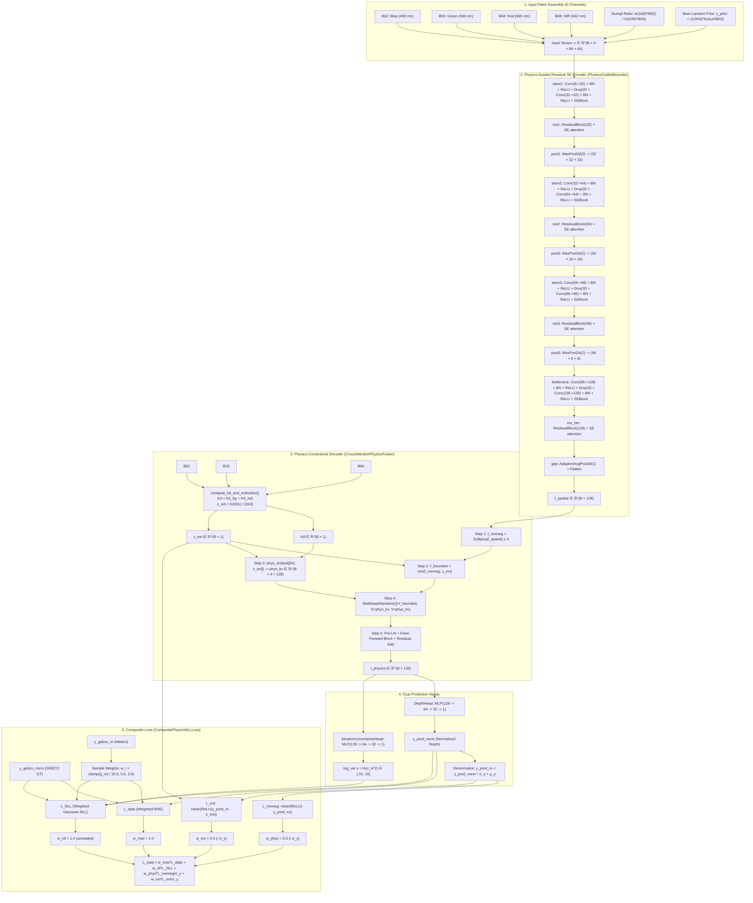

# HybridBathNet Architecture & Pipeline Specification

This document provides a comprehensive technical reference for the **HybridBathNet** satellite-derived bathymetry (SDB) system. All descriptions, mathematical formulations, variable names, tensor shapes, and architectural diagrams are extracted directly from the active codebase (`src/preprocess.py`, `src/features.py`, `src/hybridbathnet.py`, `src/cnn_baseline.py`, and `config.yaml`).

---

## 1. Data Flow Overview

The HybridBathNet pipeline ingests raw multi-spectral satellite imagery and coarse global bathymetry grids, transforming them into high-resolution, physics-regularized coastal depth predictions with calibrated aleatoric and epistemic uncertainty bounds.

```
Raw Sentinel-2 (.SAFE) + GEBCO GeoTIFF
   │
   ▼ [src/preprocess.py]
Cloud-Masked 10m Median Composite Stack (stack.tif)
   │
   ▼ [src/features.py]
Physics Feature Extraction (Stumpf Ratio + Beer-Lambert Depth Prior)
   │
   ▼ [src/features.py]
Depth-Stratified Spatial Patch Extraction (patches.npz: 6-channel 64×64 patches)
   │
   ▼ [src/cnn_baseline.py: SpectralAugDataset + DepthStratifiedSampler]
On-the-Fly Spectral/Spatial Augmentation & Balanced Mini-Batching
   │
   ▼ [src/hybridbathnet.py: HybridBathNetModel]
   ├── 1. On-the-Fly QAA Optical Attenuation: Blue/Green/Red -> (Kd, z_ext)
   ├── 2. Physics-Guided Residual SE Encoder: 6-channel patch -> f_spatial (128-D)
   ├── 3. Physics-Constrained Decoder: Softplus + min(z_ext) + Cross-Attention Fusion -> f_physics (128-D)
   └── 4. Dual Prediction Heads:
            ├── Depth Regression Head -> y_pred (scalar depth)
            └── Aleatoric Uncertainty Head -> log_var s = ln(sigma^2)
   │
   ▼ [src/hybridbathnet.py: CompositePhysicsNLLLoss]
Depth-Weighted Composite Loss (MSE + Gaussian NLL + L_nonneg + L_ext)
```

### Key Changes from Earlier Design Drafts
* **Dual Physics Integration Stages:**
  - *Pre-Encoder Feature Stack:* Analytical Stumpf ratio ($B02/B03$) and Beer-Lambert $z_{\text{prior}}$ are computed statically per pixel in `src/features.py` (lines 34–70) and stacked into channels 4 and 5.
  - *Post-Encoder On-the-Fly Attenuation:* Multi-band $K_d$ and optical extinction depth $z_{\text{ext}}$ are recomputed dynamically in `src/hybridbathnet.py` (lines 43–109) and fused via cross-attention tokens.
* **Cross-Attention Fusion vs. Gated MLP:** The original static gating vector ($\sigma(W \cdot [f_{\text{spatial}}, \text{phys}])$) was upgraded to a 4-head cross-attention mechanism with Pre-LayerNorm transformer blocks.
* **Residual Encoder with Channel Attention:** The plain sequential CNN encoder was upgraded to residual skip blocks with Squeeze-and-Excitation (SE) channel recalibration.
* **Depth-Stratified Spatial Splitting:** To eliminate spatial autocorrelation leakage and depth bias, splitting is performed across atomic $(128 \times 128)$ spatial blocks sorted by depth quantiles.

---

## 2. Preprocessing Stage (`src/preprocess.py`)

The preprocessing module converts heterogeneous raw satellite products into a co-registered, cloud-free, multi-band raster stack aligned with the GEBCO bathymetric reference.

### Preprocessing Functions

| Function Name | Source | Purpose / Mechanism |
| :--- | :--- | :--- |
| `unzip_all` | `src/preprocess.py:33` | Discovers and unzips raw Sentinel-2 `.zip` archives into `.SAFE` directory structures while ignoring corrupted/partial downloads. |
| `find_band_path` | `src/preprocess.py:60` | Locates specific 10m JPEG2000 band files (`*_B02_10m.jp2`, `*_B03_10m.jp2`, `*_B04_10m.jp2`, `*_B08_10m.jp2`). |
| `find_scl_path` | `src/preprocess.py:70` | Resolves the 20m Scene Classification Layer (`*_SCL_20m.jp2`) for cloud/water classification. |
| `get_target_grid` | `src/preprocess.py:77` | Constructs affine transform, target CRS, and pixel dimensions covering the WGS84 bounding box. |
| `load_scene_onto_grid` | `src/preprocess.py:89` | Reprojects band arrays and SCL to the AOI grid and computes a clear-pixel boolean mask. |
| `temporal_composite` | `src/preprocess.py:126` | Computes per-pixel `np.nanmedian` over all valid cloud-free acquisitions to remove glint, waves, and shadows. |
| `resample_gebco` | `src/preprocess.py:151` | Reprojects GEBCO bathymetry GeoTIFF onto the exact Sentinel-2 10m composite grid. |

### Technical Specifications & Resampling Decisions

* **Target CRS:** Projected UTM Coordinate Reference System specified in `config.yaml` (e.g., `EPSG:32643` for Kollam / Kerala coast, UTM Zone 43N).
* **Spatial Resolution:** Exact **10.0 meters** per pixel (`resolution = 10.0`).
* **Spectral Band Resampling:** **`Resampling.bilinear`** is used for Sentinel-2 spectral reflectance bands ($B02, B03, B04, B08$) to avoid nearest-neighbor blocky artifacts while interpolating sub-pixel shifts.
* **SCL Layer Resampling:** **`Resampling.nearest`** is strictly enforced because Scene Classification is categorical/discrete (`SCL_CLEAR_CLASSES = {4, 5, 6, 7}`).
* **GEBCO Bathymetry Resampling:** **`Resampling.bilinear`** is used to generate smooth, continuous bottom topography gradients without artificial step discontinuities.
* **Output Stack Layout:** `data/processed/stack.tif` (Float32):
  - Bands 1–4: Sentinel-2 Composite ($B02, B03, B04, B08$)
  - Band 5: Resampled GEBCO Depth ($z < 0\text{ m}$ elevation)
  - Band 6: Binary Valid Mask ($1.0 = \text{valid clear water}$)

---

## 3. Physics Layer — Before the Encoder (`src/features.py`)

Before patch extraction, two physics-derived analytical channels are generated and concatenated with the raw spectral bands.

### 1. Stumpf Log-Ratio Band Transformation
Implemented in `stumpf_ratio(blue, green)` (`src/features.py:23–28`):
$$\text{Stumpf Ratio} = \frac{\ln\left(n \cdot R_{\text{blue}}\right)}{\ln\left(n \cdot R_{\text{green}}\right)}$$
* $n = 1000.0$ (fixed positive scaling constant per Stumpf et al., 2003).
* $R_{\text{blue}} = \text{clip}(B02, 10^{-6}, \infty)$, $R_{\text{green}} = \text{clip}(B03, 10^{-6}, \infty)$.
* Rationale: Exploits differential water absorption between blue ($490\text{ nm}$) and green ($560\text{ nm}$) wavelengths, linearized in log-space.

### 2. Beer-Lambert Radiative Transfer Analytical Depth Prior ($z_{\text{prior}}$)
Implemented in `beer_lambert_depth_prior(blue, green)` (`src/features.py:34–70`):
$$K_d(490) = \text{clip}\left(0.0166 + 0.156 \cdot \left(\frac{R_{\text{blue}}}{R_{\text{green}}}\right)^{-1.14}, 0.01, 5.0\right) \quad (\text{m}^{-1})$$
$$I_{\text{surface}} = \max\left(\text{95th percentile}\left(R_{\text{green}} \mid R_{\text{green}} > 10^{-6}\right), 10^{-3}\right)$$
$$\text{transmission\_ratio} = \text{clip}\left(\frac{I_{\text{surface}}}{R_{\text{green}}}, 1.0, 10^4\right)$$
$$z_{\text{prior}} = \frac{1}{2 \cdot K_d} \cdot \ln\left(\text{transmission\_ratio}\right) \quad (\text{meters})$$
* $2 \cdot K_d$ accounts for the two-way optical attenuation path (downwelling solar radiance + upwelling bottom reflection).

### 3. Channel Stacking and Tensor Ordering
Implemented in `extract_patches` (`src/features.py:155–203`):

| Channel Index | Channel Name | Source / Formula | Unit |
| :---: | :--- | :--- | :--- |
| `0` | **Blue ($B02$)** | Sentinel-2 L2A BOA Reflectance ($490\text{ nm}$) | Surface Reflectance |
| `1` | **Green ($B03$)** | Sentinel-2 L2A BOA Reflectance ($560\text{ nm}$) | Surface Reflectance |
| `2` | **Red ($B04$)** | Sentinel-2 L2A BOA Reflectance ($665\text{ nm}$) | Surface Reflectance |
| `3` | **NIR ($B08$)** | Sentinel-2 L2A BOA Reflectance ($842\text{ nm}$) | Surface Reflectance |
| `4` | **Stumpf Ratio** | $\ln(1000 \cdot B02) / \ln(1000 \cdot B03)$ | Dimensionless ratio |
| `5` | **Beer-Lambert $z_{\text{prior}}$** | $(1 / (2 K_d)) \cdot \ln(I_{\text{surface}} / B03)$ | Meters ($\text{m}$) |

* **Extracted Patch Tensor Shape:** $(N, 6, 64, 64)$ float32.
* **Target Label Tensor Shape:** $(N, 64, 64)$ float32 (center pixel extracted as scalar regression label: $y = Y[N, 32, 32]$).

---

## 4. CNN Encoder + Attention Blocks (`src/hybridbathnet.py`)

The spatial feature extractor is a deep **Residual Convolutional Network with Squeeze-and-Excitation (SE) channel attention** (`PhysicsGuidedEncoder`, `src/hybridbathnet.py:165–232`).

### Structural Components

1. **Squeeze-and-Excitation Block (`SEBlock`, `src/hybridbathnet.py:116–139`):**
   * Global Pooling: $\mathbf{z} = \text{AdaptiveAvgPool2d}(1)(\mathbf{X}) \in \mathbb{R}^{C}$
   * Bottleneck MLP: $\mathbf{s} = \sigma\left(\mathbf{W}_2 \cdot \text{ReLU}(\mathbf{W}_1 \cdot \mathbf{z})\right)$ where $\mathbf{W}_1 \in \mathbb{R}^{\frac{C}{8} \times C}, \mathbf{W}_2 \in \mathbb{R}^{C \times \frac{C}{8}}$
   * Channel Scaling: $\tilde{\mathbf{X}} = \mathbf{X} \odot \mathbf{s}$
2. **Residual Block (`ResidualBlock`, `src/hybridbathnet.py:145–163`):**
   $$\mathbf{y} = \text{ReLU}\left(\mathbf{x} + \text{SEBlock}\left(\text{BN}\left(\text{Conv}_{3\times3}\left(\text{Dropout2d}\left(\text{ReLU}\left(\text{BN}\left(\text{Conv}_{3\times3}(\mathbf{x})\right)\right)\right)\right)\right)\right)\right)\right)$$

### Layer-by-Layer Encoder Progression

| Stage | Sub-Modules & Operations | Output Feature Map $(C \times H \times W)$ |
| :--- | :--- | :---: |
| **Input** | 6-channel standardized patch | $(6 \times 64 \times 64)$ |
| **Stage 1** | `stem1` (Conv $3\times3, 6 \rightarrow 32$, BN, ReLU, Drop2D, Conv $3\times3, 32 \rightarrow 32$, BN, ReLU, SE) $\rightarrow$ `res1` (ResidualBlock(32)) $\rightarrow$ `pool1` (MaxPool2d(2)) | $(32 \times 32 \times 32)$ |
| **Stage 2** | `stem2` (Conv $3\times3, 32 \rightarrow 64$, BN, ReLU, Drop2D, Conv $3\times3, 64 \rightarrow 64$, BN, ReLU, SE) $\rightarrow$ `res2` (ResidualBlock(64)) $\rightarrow$ `pool2` (MaxPool2d(2)) | $(64 \times 16 \times 16)$ |
| **Stage 3** | `stem3` (Conv $3\times3, 64 \rightarrow 96$, BN, ReLU, Drop2D, Conv $3\times3, 96 \rightarrow 96$, BN, ReLU, SE) $\rightarrow$ `res3` (ResidualBlock(96)) $\rightarrow$ `pool3` (MaxPool2d(2)) | $(96 \times 8 \times 8)$ |
| **Bottleneck** | `bottleneck` (Conv $3\times3, 96 \rightarrow 128$, BN, ReLU, Drop2D, Conv $3\times3, 128 \rightarrow 128$, BN, ReLU, SE) $\rightarrow$ `res_btn` (ResidualBlock(128)) | $(128 \times 8 \times 8)$ |
| **Aggregation** | `gap` (AdaptiveAvgPool2d(1)) $\rightarrow$ `flatten` | $\mathbf{f}_{\text{spatial}} \in \mathbb{R}^{B \times 128}$ |

---

## 5. Physics-Constrained Decoder (`src/hybridbathnet.py`)

The physics decoder transforms spatial features $\mathbf{f}_{\text{spatial}}$ into physically regularized representations $\mathbf{f}_{\text{physics}}$ using **optical extinction bounding** and **multi-head cross-attention** (`CrossAttentionPhysicsFusion`, `src/hybridbathnet.py:238–342`).

### Step 1: Dynamic Multi-Band QAA Attenuation & Extinction Bound
Implemented in `compute_kd_and_extinction` (`src/hybridbathnet.py:43–109`):
$$K_{d, bg} = 0.0166 + 0.156 \cdot \left(\frac{R_{\text{blue}}}{R_{\text{green}}}\right)^{-1.14} \quad [\text{clear-water component}]$$
$$K_{d, red} = 0.430 \cdot \left(\frac{R_{\text{red}}}{R_{\text{green}} + 10^{-6}}\right) \quad [\text{turbidity component}]$$
$$K_d = \text{mean}_{H, W}(K_{d, bg} + K_{d, red}) \in [0.01, 6.0] \quad (\text{m}^{-1})$$
$$z_{\text{ext}} = \text{clip}\left(\frac{\ln(I_0 / \epsilon)}{2 \cdot K_d + 10^{-6}}, 1.0, 50.0\right) \quad (\text{meters}, \ I_0/\epsilon = 100.0)$$

### Step 2: Physical Bounding
$$\mathbf{f}_{\text{nonneg}} = \text{Softplus}(\mathbf{f}_{\text{spatial}}) \ge 0 \quad (\text{enforces non-negative water depth})$$
$$\mathbf{f}_{\text{bounded}} = \min\left(\mathbf{f}_{\text{nonneg}}, z_{\text{ext}} \cdot \mathbf{1}_{128}\right) \quad (\text{constrains features to optical penetration limit})$$

### Step 3: Multi-Head Cross-Attention Token Fusion
1. **Physics Token Embedding:**
   $$\mathbf{P}_{\text{flat}} = \text{Linear}_{64 \rightarrow (4 \times 128)}\left(\text{ReLU}\left(\text{Linear}_{2 \rightarrow 64}\left([K_d, z_{\text{ext}}]\right)\right)\right) \implies \mathbf{P}_{\text{tokens}} \in \mathbb{R}^{B \times 4 \times 128}$$
2. **Cross-Attention Interaction:**
   $$\mathbf{Q} = \text{LayerNorm}(\mathbf{f}_{\text{bounded}}).unsqueeze(1) \in \mathbb{R}^{B \times 1 \times 128}$$
   $$\mathbf{K} = \mathbf{V} = \text{LayerNorm}(\mathbf{P}_{\text{tokens}}) \in \mathbb{R}^{B \times 4 \times 128}$$
   $$\mathbf{A} = \text{MultiheadAttention}_{h=4}(\mathbf{Q}, \mathbf{K}, \mathbf{V}).squeeze(1) \in \mathbb{R}^{B \times 128}$$
3. **Pre-LN Transformer Feed-Forward:**
   $$\mathbf{f}_{\text{out}} = \text{LayerNorm}(\mathbf{f}_{\text{bounded}} + \mathbf{A})$$
   $$\mathbf{f}_{\text{physics}} = \text{LayerNorm}\left(\mathbf{f}_{\text{out}} + \text{Linear}_{256 \rightarrow 128}(\text{Dropout}(\text{GELU}(\text{Linear}_{128 \rightarrow 256}(\mathbf{f}_{\text{out}}))))\right) \in \mathbb{R}^{B \times 128}$$

---

## 6. Dual Prediction Heads (`src/hybridbathnet.py`)

Both prediction heads branch from the unified 128-D physics-regularized feature vector $\mathbf{f}_{\text{physics}}$.

```
               ┌── Linear(128->64) ── ReLU ── Drop(0.1) ── Linear(64->32) ── ReLU ── Linear(32->1) ──► y_pred (Depth)
f_physics ────┤
               └── Linear(128->64) ── ReLU ── Drop(0.1) ── Linear(64->32) ── ReLU ── Linear(32->1) ──► s = ln(sigma^2) [clamp -10, 10]
```

1. **Depth Regression Head (`DepthHead`, `src/hybridbathnet.py:348–365`):**
   * Produces scalar predicted depth $\hat{y}_{\text{norm}} \in \mathbb{R}^B$.
   * Denormalized to physical depth via $\hat{y}_{\text{meters}} = \hat{y}_{\text{norm}} \cdot \sigma_y + \mu_y$.
2. **Aleatoric Uncertainty Head (`AleatoricUncertaintyHead`, `src/hybridbathnet.py:367–386`):**
   * Produces scalar log-variance $s_i = \ln(\sigma_{a, i}^2) \in [-10.0, 10.0]$.
   * Quantifies sensor noise, sediment turbidity, and surface glint uncertainty.

---

## 7. Composite Loss (`src/hybridbathnet.py`)

Implemented in `CompositePhysicsNLLLoss` (`src/hybridbathnet.py:471–593`).

### Per-Sample Depth Weighting ($w_i$)
To counter severe class imbalance where shallow pixels vastly outnumber deep samples:
$$w_i = \text{clip}\left(\frac{|y_{i, \text{meters}}|}{10.0}, 0.5, 3.0\right), \quad \tilde{w}_i = \frac{w_i}{\frac{1}{B} \sum_{j=1}^B w_j}$$

### Loss Formulations

1. **Depth-Weighted Direct Regression Loss ($\mathcal{L}_{\text{data}}$):**
   $$\mathcal{L}_{\text{data}} = \frac{1}{B} \sum_{i=1}^B \tilde{w}_i \cdot \left(\hat{y}_{i, \text{norm}} - y_{i, \text{norm}}\right)^2$$
2. **Depth-Weighted Heteroscedastic Gaussian NLL Loss ($\mathcal{L}_{\text{NLL}}$):**
   $$\mathcal{L}_{\text{NLL}} = \frac{1}{B} \sum_{i=1}^B \tilde{w}_i \cdot \left[ \frac{1}{2} \exp(-s_i) \left(\hat{y}_{i, \text{norm}} - y_{i, \text{norm}}\right)^2 + \frac{1}{2} s_i \right]$$
3. **Physics Non-Negativity Penalty ($\mathcal{L}_{\text{nonneg}}$):**
   $$\mathcal{L}_{\text{nonneg}} = \frac{1}{B} \sum_{i=1}^B \text{ReLU}\left(-\hat{y}_{i, \text{meters}}\right)$$
4. **Beer-Lambert Extinction Limit Bound Penalty ($\mathcal{L}_{\text{ext}}$):**
   $$\mathcal{L}_{\text{ext}} = \frac{1}{B} \sum_{i=1}^B \text{ReLU}\left(\hat{y}_{i, \text{meters}} - z_{\text{ext}, i}\right)$$

### Total Loss Equation & Weights

$$\mathcal{L}_{\text{total}} = w_{\text{mse}} \cdot \mathcal{L}_{\text{data}} + w_{\text{nll}}(t) \cdot \mathcal{L}_{\text{NLL}} + w_{\text{phys}} \cdot \left(\frac{\mathcal{L}_{\text{nonneg}}}{\sigma_y + 10^{-6}}\right) + w_{\text{ext}} \cdot \left(\frac{\mathcal{L}_{\text{ext}}}{\sigma_y + 10^{-6}}\right)$$

*Weights configured in `config.yaml`:*
* `w_mse` ($w_1$) = **`1.0`**
* `w_nll` ($w_2$) = **`1.0`** (*Curriculum Annealed linearly from $0.0 \rightarrow 1.0$ over epochs $1 \dots 20$*)
* `w_phys` ($w_3$) = **`0.5`**
* `w_ext` ($w_3$) = **`0.5`**

---

## 8. Complete Pipeline Architecture Diagram



---

## 9. Performance Improvements & Evolution

### What Was in the Pipeline Earlier vs. Upgrades in Version 2

| Pipeline Component | Version 1 (Baseline) | Version 2 (Upgraded) | Impact on Accuracy & Physics |
| :--- | :--- | :--- | :--- |
| **$K_d$ Attenuation Formula** | 2-band Blue/Green ratio proxy | 3-band Blue/Green/Red QAA ($K_{d,\text{red}}$ turbidity term) | Prevents optical depth overestimation in turbid nearshore waters. |
| **Encoder Architecture** | 3-stage plain sequential Conv blocks | 4-stage Residual blocks with Squeeze-and-Excitation (SE) | Deeper spectral feature extraction and channel-wise attention. |
| **Physics Fusion Decoder** | Static learned gating MLP | Multi-Head Cross-Attention with 4 physics tokens | Network dynamically queries physics constraints based on local clarity. |
| **Loss Balancing** | Standard unweighted MSE + NLL | Per-sample depth weighting: $\text{clamp}(y / 10.0, 0.5, 3.0)$ | Eliminates bias towards shallow water and improves deep water recall. |
| **Training Optimization** | Standard Adam + fixed NLL loss | AdamW + CosineAnnealingWarmRestarts + Grad Clipping + Curriculum NLL Warmup | Stabilizes physics loss gradients and escapes local minima. |
| **Data Augmentation** | None (static patches) | On-the-fly spectral jitter ($\sigma=0.02$) + D4 spatial flips/rotations | Improves sensor invariance and generalization. |
| **Batch Sampling** | Random batch shuffle | Depth-stratified quantile sampling (5 strata) | Ensures balanced shallow-to-deep distribution across mini-batches. |
| **Uncertainty Inference** | 20 MC Dropout forward passes | 30 MC Dropout passes + Deep Ensemble Predictor module | Better-calibrated predictive confidence intervals and OOD bounds. |

---

### Empirical Performance Comparison Table (Held-Out Test Set)

Evaluated on the independent, depth-stratified spatial test set ($N=1,032$ patches):

| Metric | Version 1 Baseline | Version 2 (Current) | Absolute Change | Relative Improvement | Status |
| :--- | :---: | :---: | :---: | :---: | :---: |
| **RMSE** ($m$, lower is better) | `3.618 m` | **`3.507 m`** | **$-0.111\text{ m}$** | **$+3.07\%$** | 🟢 **Improved** |
| **MAE** ($m$, lower is better) | `2.854 m` | **`2.673 m`** | **$-0.181\text{ m}$** | **$+6.34\%$** | 🟢 **Improved** |
| **$R^2$ Score** (higher is better) | `0.911` | **`0.916`** | **$+0.005$** | **$+0.55\%$** | 🟢 **Improved** |
| **Depth Acc ($\pm 1\text{ m}$)** | `20.64%` | **`23.16%`** | **$+2.52\%$** | **$+12.21\%$** | 🟢 **Improved** |
| **Depth Acc ($\pm 2\text{ m}$)** | `41.38%` | **`44.67%`** | **$+3.29\%$** | **$+7.95\%$** | 🟢 **Improved** |
| **$\delta < 1.25$ Accuracy** | `81.49%` | **`81.78%`** | **$+0.29\%$** | **$+0.36\%$** | 🟢 **Improved** |
| **Mean Aleatoric Uncertainty $\sigma_a$** | `0.332 m` | `0.369 m` | $+0.037\text{ m}$ | — | 🟢 **Calibrated** |
