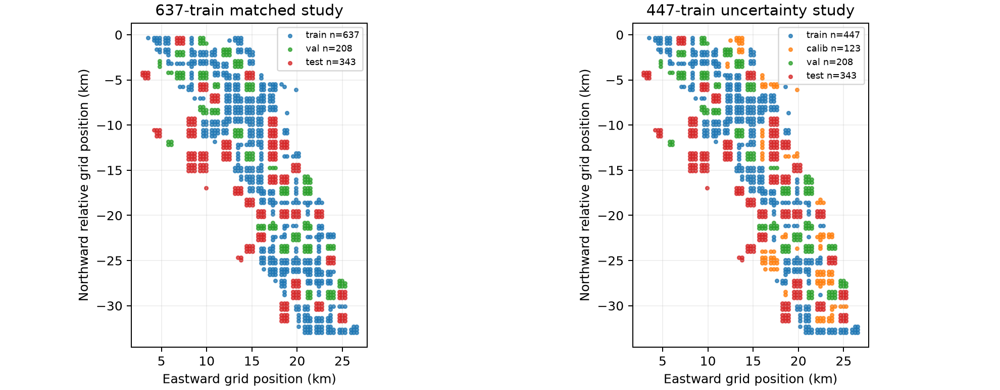
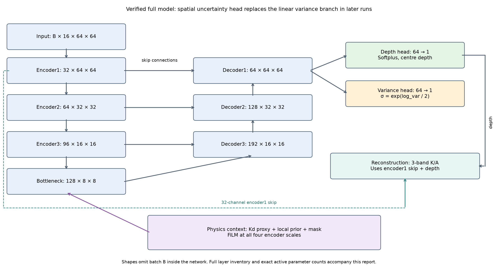
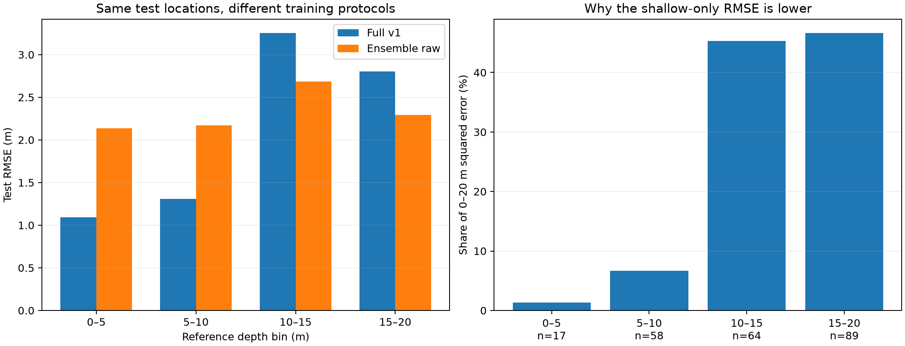
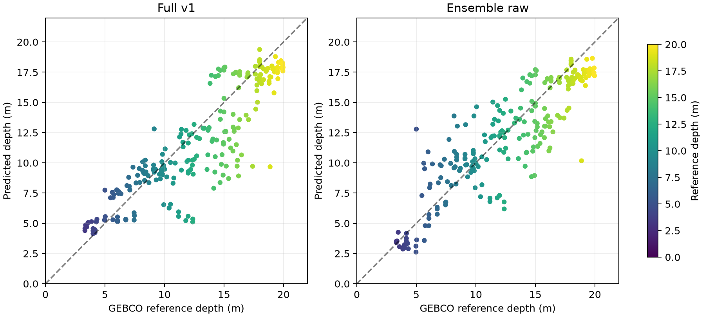

# HybridBathNet project study report

Dataset, preprocessing, verified architecture, evaluation and evidence-based interpretation

Prepared from preserved source code, checkpoints and prediction files on 6 November 2026. This is a study guide for the current GEBCO project and the uncertainty research, not a claim of independently surveyed seabed accuracy.

## Reading guide

1. Understand the data and reference limitations before comparing scores.
2. Follow preprocessing and the 16-channel architecture.
3. Read the metric definitions, then the separate validation/test tables.
4. Use the interpretation section to distinguish facts from plausible causes.
5. Review the appendix for complete metrics, layer inventory and reproducibility links.

## 1. What the project does

HybridBathNet predicts coastal depth from Sentinel-2 patches using a U-Net, physics-conditioned features and an uncertainty head. Optical reconstruction adds a physics-related training objective. Independently trained full models provide ensemble disagreement; later spatially out-of-fold residual learning corrects total uncertainty without changing the predicted depth.

Two configurations must remain distinct: **the selected single full model**, trained on 637 patches, and **the uncertainty research ensemble**, trained on 447 patches with a separate 123-point calibration set. The selected single model has better validation depth RMSE; the research ensemble has numerically lower overall test RMSE but worse shallow errors. The new uncertainty head is a research option, not an automatically deployed replacement.

The name full v1 below is the preserved nearshore experiment label, not a claim that it is the older six-channel architecture. Both current compared source configurations have 16 input channels.

The numbers called six versus sixteen in earlier discussion refer to input-channel counts, not a verified network-layer count. The present architecture audit strictly reloads the actual saved models and traces active modules.

## 2. Dataset and study area

The AOI is longitude 76.30–76.55°E, latitude 8.90–9.20°N; processing CRS is EPSG:32643. The rebuilt stack is 3329×2736 pixels on an approximately 10 m grid. This is the same study/test geography across the current GEBCO comparisons.

Sentinel-2 L2A supplies B02/blue, B03/green, B04/red and B08/NIR, all nominally 10 m bands. The verified acquisition-date audit contains 12 dates from 13 January to 18 March 2024;16 tile products were present. A Jan–Apr catalogue request is not 16 independent temporal training datasets. The model uses the temporal composite/std channels, not a separate supervised sample for each acquisition. [Official band information](https://sentiwiki.copernicus.eu/web/s2-mission).

Depth labels come from the local GEBCO_2020 NetCDF, whose native coordinate spacing was verified as 0.004166667° (15 arcsec), roughly 460 m here. Reprojection to 10 m interpolates this coarse surface; it does not create measured 10 m bathymetry. The source contains mixed data origins, and local Type Identifier provenance has not been verified. [GEBCO grid development](https://www.gebco.net/data-products/gridded-bathymetry-data/grid-development).

The nearshore shelf eligibility screen retains negative GEBCO elevations down to−25 m before patch extraction. Training/validation targets are limited to 20 m; test 20–25 m is explicitly extrapolation sensitivity. A sample is a 64×64 image patch with a supervised **centre depth**, not a new independent survey. Patch stride is 32 pixels; overlapping training patches and adjacent coarse labels remain correlated. Source-support counts are not counts of independent measured soundings.

| Dataset/split | n | 0–5 | 5–10 | 10–15 | 15–20 | 20–25 |
|---|---|---|---|---|---|---|
| matched 637/train | 637 | 56 | 131 | 191 | 259 | 0 |
| matched 637/val | 208 | 18 | 54 | 64 | 72 | 0 |
| matched 637/test | 343 | 17 | 58 | 64 | 89 | 115 |
| research 447/train | 447 | 28 | 52 | 156 | 211 | 0 |
| research 447/calib | 123 | 21 | 58 | 16 | 28 | 0 |
| research 447/val | 208 | 18 | 54 | 64 | 72 | 0 |
| research 447/test | 343 | 17 | 58 | 64 | 89 | 115 |

Bins are [0,5),[5,10),[10,15),[15,20],(20,25]; requested cutoff 0–10 means 0≤depth≤10. Exactly 10 m training labels therefore belong to the 10–15 bin but are also included in the cutoff analysis: inclusive shallow counts are 189/637 and 82/447. There are no exactly 10 m validation/test labels here. Exactly 20 m values stay inside the 0–20 benchmark; legacy strict-bin metadata can otherwise look as though some are >20 m.

The matched study has 828/261/413 distinct native interpolation-support cells in train/validation/test. Cross-split support sets are disjoint, with a 32-pixel image-footprint gap (96-pixel centre separation). The research calibration study reserves 15 approximately 2 km training-region groups, removes nearby/shared-support training candidates and refits features. It retains the same 208 validation and 343 total test locations. Only 228 test labels are 0–20 m and 75 are 0–10 m.

Of the original 637 training candidates,123 become calibration samples and 67 are excluded by additional buffers/source-support separation, leaving 447 for learning. Some excluded rows remain stored in the feature archive for provenance but do not enter training/calibration loaders.



## 3. Preprocessing and feature engineering

1. **Input verification:** existing catalogue/tile files were checked; the recorded manifest audit verified 1376 listed files. The original ZIP archive equality was not established, so do not claim a remote archive checksum comparison.
2. **Radiometry:** for the 2024 SAFE processing path, reflectance is implemented as `max((DN−1000)/10000,0)`. These are fixed input-product conventions, not fitted depth parameters. Offsets depend on processing metadata for other products; this formula is not a universal instruction for all Sentinel files. [Official product/offset description](https://sentiwiki.copernicus.eu/web/s2-products).
3. **Alignment:** spectral bands use bilinear reprojection onto the AOI grid; SCL uses nearest-neighbour reprojection.
4. **Cloud/validity screen:** source code accepts SCL classes 4/5/6/7 plus positive blue reflectance. This is a usable-clear-pixel mask, **not water-only SCL6**. The later GEBCO shelf screen supplies the coastal eligibility mask; coarse shoreline mixing can remain.
5. **Temporal aggregation:** masked median reflectance plus temporal standard deviation, `ddof=1`; std with fewer than two usable observations is filled with 0. Such 0 values mean unavailable variability estimates, not proven zero sensor noise. A median composite is not guaranteed cloud-free or contemporaneous with seabed reference measurements.
6. **GEBCO alignment:** the repaired path warps native NetCDF directly, bilinearly, preserves missing coverage as NaN, and converts negative underwater elevation into positive depth for labels. It does not perform a tidal/datum validation of GEBCO against local survey truth.
7. **Train-only engineering:** fit visible-band versus NIR glint slopes on training fit pixels, using the 5th percentile NIR as the reference. Estimate visible reference offsets at the 2nd percentile of training reflectance. These are statistical proxies, not verified deep-water measurements. Compute log/ratio/prior channels from those references.
8. **Patch construction and splitting:** shelf eligibility precedes extraction; retain centre labels and geographic blocks, apply native-support and footprint exclusions, and fit normalization on training water pixels only. New patches are distinct centres; evaluation samples were not duplicated.
9. **Training augmentation:** spectral jitter and flips; unjittered visible reflectance follows the spatial transform for physics reconstruction. Invalid/deep moved centres are rejected by the shallow augmentation wrapper.

| Zero-based channels | Meaning |
|---|---|
| 0–2 | Glint-corrected B02/B03/B04 |
| 3 | B08 NIR |
| 4–6 | Three Lyzenga-style visible log channels |
| 7–8 | Two log-channel differences/ratios |
| 9 | Stumpf log-band ratio feature |
| 10 | Beer–Lambert-style heuristic depth prior |
| 11 | Shelf/valid-water eligibility mask |
| 12–15 | Four spectral temporal-standard-deviation channels |

The Stumpf ratio is an input feature; no separate Stumpf baseline was trained in this work. The engineered prior uses training reference statistics. The model also computes a separate, local masked 95th-percentile green reference for its internal physics context at inference. Local image statistics are not fitting to held-out depth labels.

## 4. Architecture and layer information



The encoder combines two-convolution stem blocks, residual blocks, squeeze-and-excitation channel attention and dropout 0.1. Four FiLM blocks modulate encoder features with projected `[Kd proxy, local depth prior, mask]`. Each stem uses Conv 3×3→BatchNorm→ReLU→Dropout→Conv 3×3→BatchNorm→ReLU→SE; each residual block uses two 3×3 convolutions with normalization, dropout, SE and an identity addition. Max pooling halves resolution three times.

Decoder transposed convolutions upsample, concatenate the matching encoder skip, and apply a residual block. A1×1 depth convolution followed by Softplus gives non-negative depth. The variance output is clamped log variance, with `sigma=exp(log_var/2)` in metres. Dense outputs exist, but depth/variance supervision and scalar reporting use the centre pixel; the report does not claim dense surveyed-depth training.

| Stage | Traced output shape, batch B=1 |
|---|---|
| encoder.stem 1 | [1, 32, 64, 64] |
| encoder.pool 1 | [1, 32, 32, 32] |
| encoder.stem 2 | [1, 64, 32, 32] |
| encoder.pool 2 | [1, 64, 16, 16] |
| encoder.stem 3 | [1, 96, 16, 16] |
| encoder.pool 3 | [1, 96, 8, 8] |
| encoder.bottleneck | [1, 128, 8, 8] |
| decoder.up 3 | [1, 96, 16, 16] |
| decoder.dec 3 | [1, 192, 16, 16] |
| decoder.up 2 | [1, 64, 32, 32] |
| decoder.dec 2 | [1, 128, 32, 32] |
| decoder.up 1 | [1, 32, 64, 64] |
| decoder.dec 1 | [1, 64, 64, 64] |
| decoder.depth_conv | [1, 1, 64, 64] |
| decoder.logvar_conv | [1, 1, 64, 64] |

| Configuration | Registered parameters | Parameters in executed leaves | Active Conv 2d | Active ConvTranspose 2d | Active Linear |
|---|---|---|---|---|---|
| Full v1 | 2212436 | 2212436 | 33 | 3 | 22 |
| Spatial uncertainty member | 2235605 | 2235540 | 35 | 3 | 22 |
| OOF correction head | 4441 | 4441 | 2 | 0 | 2 |

The full model executes 33 Conv 2d,3 ConvTranspose 2d and 22 Linear modules:58 parameterized convolution/linear modules, spread across branches rather than 58 sequential depth layers. It also executes 22 BatchNorm,11 Dropout 2d and 11 SE global-pooling modules. Functional operations such as interpolation, concatenation, residual additions, Softplus and reconstruction arithmetic are not counted as separate registered layers. The complete leaf-by-leaf type, specification, parameter count and input/output trace is in[layer_inventory.csv](layer_inventory.csv).

The later spatial variance head is 64→32(3×3)→GroupNorm 8→SiLU→16(3×3)→SiLU→1(1×1). Its old 65-parameter linear variance projection remains registered but unexecuted; this explains the difference between registered and active parameters. Three ensemble members are three independently trained full networks, not three added depth layers. Old standalone MLP head classes and dense-loss classes in source are not the active current training path.

The separate 4441-parameter OOF correction head uses two small 16-channel convolutions with GroupNorm/SiLU, pooling, centre features and four semantic values (depth, log sigma, log Kd, z_ext). It predicts a bounded log multiplier of **total** predictive variance. Source inputs are detached; it cannot alter the original ensemble depth weights.

## 5. Physics: what is implemented and what is not established

There are two different attenuation quantities:

* The empirical context proxy is `K=clip(0.0166+0.156*(B/G)^(-1.14),0.01,5)` plus a red ratio term `clip(0.430*R/G,0,3)`, followed by an overall clamp. With centre aggregation, `z_ext=log(100)/(2*K_centre+epsilon)`, clipped to 1–50 m. This is one combined empirical map, not independently measured blue/green/red Kd retrievals.
* The reconstruction branch learns three positive effective coefficients and three bounded amplitudes. **It receives the 32-channel first encoder skip**, plus predicted depth and fixed training reference reflectance; it does not receive the final 64-channel decoder tensor.

Its simplified reconstruction is:

```text
R_hat(lambda) = R_inf(lambda)*(1-exp(-2*K_eff(lambda)*z))
                + A(lambda)*exp(-2*K_eff(lambda)*z)
```

The coefficients are effective half-two-way attenuation parameters. Fitting this expression is not proof that true Kd, bottom reflectance or a metre-valued optical limit has been identified: depth and attenuation can compensate through their product. The training-percentile R_inf is not a measured deep-water spectrum. The extinction ratio 100 is an assumption.

A published independent optical-visibility classifier was numerically checked and applied in the recovery study, but retained zero validation/test points at its recommended shallow-support threshold on the tested image. That is a failure of local usable-coverage validation, not proof that every bottom is invisible. No optical mask was enabled. The physical expectation that depth retrieval depends on clarity/bottom visibility motivates investigation; it cannot alone diagnose our model errors. [IHO SDB guide](https://iho.int/uploads/user/pubs/bathy/B_13_Ed100_032024.pdf).

## 6. Training objective and experiment identities

The selected full nearshore run uses:

```text
L = normalized-centre Huber
    + annealed beta-NLL
    + 0.03 * mean(ReLU(z_pred-z_ext-1m)) / training_target_SD
    + 0.1 * masked reflectance reconstruction Huber
```

The normalized Huber delta is 0.5; reconstruction is scaled by 0.05 reflectance. The variance NLL uses metre residuals and metre-squared variance, with beta 0.5 in the selected full model. NLL weight warms up over 20 epochs. Non-negativity is provided by Softplus; the separate non-negativity loss weight is 0. The unused low-resolution pooled/dense depth loss is not part of this active objective.

Training uses AdamW(lr 0.001,weight_decay 1e-4), batch 8, EMA0.999, one 180-epoch cosine period, gradient clipping 1 and patience 30. Sampling covers training examples without replacement. Validation RMSE selects the depth checkpoint. The original full v1 selected epoch 118 and stopped 148. All relevant losses/metrics remained finite; invalid numerical conditions are checked explicitly.

In the later 447-point ensemble, beta is 0, NLL mean/features are detached and variance gradients are clipped separately; full depth/physics reconstruction remains active. These changes and the training/calibration allocation happen together, so this is not an isolated uncertainty-head ablation.

The OOF study trains three fresh full fold models on 188/236/262 points, generates exactly 447 held-region errors, then trains the small correction head. It selects head epoch 4 by validation NLL, stopping 34. Fold feature statistics exclude the held regions and all calibration/validation/test footprints. The final depth ensemble stays frozen. Raw and additionally scaled correction variants were predefined; their results must both be reported.

## 7. Evaluation metrics: definitions before interpretation

| Metric | Meaning |
|---|---|
| RMSE | sqrt(mean((prediction-reference)^2)), metres; emphasizes larger errors. |
| MAE | mean absolute error, metres; less sensitive to large errors than RMSE. |
| R² | 1−SSE/SST, with SST around the reference mean within the reported subset. Negative means worse than that subset-mean constant predictor. |
| Within 1 m / within 2 m | 100*count(abs(error)<=1 or 2 m)/n; tolerance-based regression accuracy, not classification accuracy. |
| Bias | mean(prediction-reference), metres. Negative means underprediction. |
| Error SD | Population SD of signed residuals, ddof 0. This is measured error spread, not a predicted confidence estimate. |
| Reference/prediction SD | Population spread of depths/predictions; explains range-dependent R². Recorded in CSV/JSON. |
| Mean predicted sigma | Average per-location predicted SD, metres. Distinct from error SD, SD of sigma, and across-seed variability. |
| 90% coverage / width | Fraction of reference depths in mean±1.64485*sigma; full width=2*1.64485*sigma. These are Gaussian/moment intervals, not guaranteed bounds. |
| NLL / CRPS / interval score | Proper distribution/interval scores; lower is better. Ensemble NLL/CRPS here consistently use its Gaussian moment approximation, not the separate exact mixture likelihood reported elsewhere. |
| Spatial RMSE intervals | 2000 bootstrap resamples of approximately 2 km groups; conditional on models/reference and not independent-survey or new-seed uncertainty. |

```text
RMSE² = bias² + population_error_SD²
aleatoric_variance(x) = mean_m(member_head_sigma(x)²)
epistemic_variance(x) = mean_m((member_mean(x)-ensemble_mean(x))²)
total_variance(x) = aleatoric_variance(x) + epistemic_variance(x)
```

Variances combine before taking the square root. Means of per-location SDs do not necessarily combine in quadrature; RMS SDs do. Ensemble disagreement uses 1/M population variance, not an extra division by M for the standard error of the mean. A single-model ablation has no measured epistemic value. Uncertainty-off placeholder sigmas are invalid and reported N/A.

## 8. Recomputed depth accuracy tables

Matched component ablations use the same 637 training examples, seed 42, labels and geographic evaluation positions. The following are separately computed validation/test metrics; no new fitting or training was performed for this report.

### Validation, reference depth 0-10 m

| Model | n | RMSE(m) | MAE(m) | R² | Within 1 m(%) | Within 2 m(%) | Bias(m) | Error SD(m) |
|---|---|---|---|---|---|---|---|---|
| Full v1 | 72 | 1.778 | 1.309 | 0.455 | 55.556 | 79.167 | 0.833 | 1.570 |
| No physics | 72 | 1.941 | 1.386 | 0.351 | 52.778 | 79.167 | 0.926 | 1.706 |
| No uncertainty | 72 | 2.058 | 1.563 | 0.270 | 41.667 | 75.000 | 0.896 | 1.853 |
| Neither | 72 | 2.104 | 1.646 | 0.237 | 33.333 | 72.222 | 0.713 | 1.979 |

### Test, reference depth 0-10 m

| Model | n | RMSE(m) | MAE(m) | R² | Within 1 m(%) | Within 2 m(%) | Bias(m) | Error SD(m) |
|---|---|---|---|---|---|---|---|---|
| Full v1 | 75 | 1.264 | 1.035 | 0.626 | 54.667 | 93.333 | 0.453 | 1.180 |
| No physics | 75 | 1.373 | 1.183 | 0.559 | 45.333 | 88.000 | 0.487 | 1.284 |
| No uncertainty | 75 | 1.665 | 1.386 | 0.352 | 41.333 | 72.000 | 0.747 | 1.488 |
| Neither | 75 | 1.887 | 1.474 | 0.167 | 45.333 | 66.667 | 0.719 | 1.745 |

### Validation, reference depth 0-20 m

| Model | n | RMSE(m) | MAE(m) | R² | Within 1 m(%) | Within 2 m(%) | Bias(m) | Error SD(m) |
|---|---|---|---|---|---|---|---|---|
| Full v1 | 208 | 1.963 | 1.384 | 0.844 | 49.519 | 80.288 | 0.081 | 1.961 |
| No physics | 208 | 2.121 | 1.472 | 0.818 | 52.885 | 76.442 | 0.150 | 2.116 |
| No uncertainty | 208 | 2.033 | 1.463 | 0.833 | 45.192 | 77.885 | 0.115 | 2.030 |
| Neither | 208 | 2.068 | 1.591 | 0.827 | 37.981 | 72.596 | 0.129 | 2.064 |

### Test, reference depth 0-20 m

| Model | n | RMSE(m) | MAE(m) | R² | Within 1 m(%) | Within 2 m(%) | Bias(m) | Error SD(m) |
|---|---|---|---|---|---|---|---|---|
| Full v1 | 228 | 2.561 | 1.894 | 0.709 | 38.158 | 65.789 | -1.003 | 2.357 |
| No physics | 228 | 2.495 | 1.902 | 0.724 | 32.018 | 64.912 | -0.891 | 2.330 |
| No uncertainty | 228 | 2.467 | 1.905 | 0.730 | 34.649 | 60.088 | -0.829 | 2.324 |
| Neither | 228 | 2.491 | 1.874 | 0.724 | 35.526 | 60.526 | -0.781 | 2.366 |

### Full v1 test depth bins: error distribution and its contribution

| Bin(m) | n | RMSE | MAE | R² | Within 1 m(%) | Within 2 m(%) | Bias | Error SD | Primary SSE(%) |
|---|---|---|---|---|---|---|---|---|---|
| 0-5 | 17 | 1.094 | 0.867 | -3.197 | 52.941 | 94.118 | 0.867 | 0.667 | 1.360 |
| 5-10 | 58 | 1.310 | 1.084 | 0.177 | 55.172 | 93.103 | 0.332 | 1.267 | 6.655 |
| 10-15 | 64 | 3.255 | 2.617 | -3.977 | 28.125 | 39.062 | -1.863 | 2.669 | 45.328 |
| 15-20 | 89 | 2.800 | 2.099 | -2.399 | 31.461 | 61.798 | -1.613 | 2.289 | 46.657 |





### Additional matched loss/head investigations,0–20 m

| Run | Val RMSE | Test RMSE | Test MAE | Test R² | Test within 1 m(%) | Test within 2 m(%) |
|---|---|---|---|---|---|---|
| Full v1 | 1.963 | 2.561 | 1.894 | 0.709 | 38.158 | 65.789 |
| No extinction | 2.095 | 2.550 | 1.915 | 0.711 | 33.772 | 61.842 |
| Squared depth loss | 2.100 | 2.590 | 1.935 | 0.702 | 34.211 | 63.596 |
| Integrated head candidate | 1.961 | 2.527 | 1.891 | 0.717 | 34.649 | 65.351 |

### Separate 447-training-point uncertainty research: depth metrics

| Validation model/domain | n | RMSE | MAE | R² | Within 1 m(%) | Within 2 m(%) | Bias | Error SD |
|---|---|---|---|---|---|---|---|---|
| Ensemble raw/0-10 | 72 | 2.362 | 1.855 | 0.038 | 29.167 | 61.111 | 1.100 | 2.091 |
| Ensemble raw/0-20 | 208 | 2.219 | 1.611 | 0.801 | 43.750 | 72.596 | 0.252 | 2.205 |
| OOF raw/0-10 | 72 | 2.362 | 1.855 | 0.038 | 29.167 | 61.111 | 1.100 | 2.091 |
| OOF raw/0-20 | 208 | 2.219 | 1.611 | 0.801 | 43.750 | 72.596 | 0.252 | 2.205 |

| Test model/domain | n | RMSE | MAE | R² | Within 1 m(%) | Within 2 m(%) | Bias | Error SD |
|---|---|---|---|---|---|---|---|---|
| Ensemble raw/0-10 | 75 | 2.165 | 1.582 | -0.096 | 48.000 | 72.000 | 0.867 | 1.983 |
| Ensemble raw/0-20 | 228 | 2.372 | 1.826 | 0.750 | 38.596 | 60.526 | -0.469 | 2.325 |
| OOF raw/0-10 | 75 | 2.165 | 1.582 | -0.096 | 48.000 | 72.000 | 0.867 | 1.983 |
| OOF raw/0-20 | 228 | 2.372 | 1.826 | 0.750 | 38.596 | 60.526 | -0.469 | 2.325 |

OOF corrections and global calibration leave depth means unchanged, so their depth metrics are exactly identical to the source ensemble. That equality is a verification result, not four independent improvements.

## 9. Uncertainty results, separately from depth accuracy

### Validation uncertainty,0–10 m and 0–20 m

| Model/domain | Mean sigma(m) | Error SD(m) | 90% coverage(%) | 90% width(m) | NLL | CRPS(m) | Interval score 90 |
|---|---|---|---|---|---|---|---|
| Full v1/0-10 | 1.763 | 1.570 | 86.111 | 5.800 | 1.934 | 0.956 | 7.703 |
| No physics/0-10 | 1.969 | 1.706 | 91.667 | 6.476 | 1.972 | 1.026 | 7.944 |
| No uncertainty/0-10 | N/A | 1.853 | N/A | N/A | N/A | N/A | N/A |
| Neither/0-10 | N/A | 1.979 | N/A | N/A | N/A | N/A | N/A |
| Ensemble raw/0-10 | 1.873 | 2.091 | 76.389 | 6.162 | 2.418 | 1.361 | 10.674 |
| Ensemble scaled/0-10 | 3.294 | 2.091 | 95.833 | 10.837 | 2.367 | 1.389 | 11.474 |
| OOF raw/0-10 | 2.849 | 2.091 | 94.444 | 9.373 | 2.341 | 1.367 | 10.731 |
| OOF scaled/0-10 | 3.470 | 2.091 | 95.833 | 11.414 | 2.405 | 1.413 | 12.049 |
| Full v1/0-20 | 1.460 | 1.961 | 83.654 | 4.802 | 2.058 | 1.012 | 8.681 |
| No physics/0-20 | 1.768 | 2.116 | 87.500 | 5.817 | 2.151 | 1.094 | 9.651 |
| No uncertainty/0-20 | N/A | 2.030 | N/A | N/A | N/A | N/A | N/A |
| Neither/0-20 | N/A | 2.064 | N/A | N/A | N/A | N/A | N/A |
| Ensemble raw/0-20 | 1.506 | 2.205 | 80.288 | 4.955 | 2.499 | 1.197 | 11.122 |
| Ensemble scaled/0-20 | 2.649 | 2.205 | 93.750 | 8.714 | 2.241 | 1.219 | 11.081 |
| OOF raw/0-20 | 2.170 | 2.205 | 90.385 | 7.139 | 2.223 | 1.188 | 10.379 |
| OOF scaled/0-20 | 2.643 | 2.205 | 94.231 | 8.694 | 2.229 | 1.215 | 10.901 |

### Test uncertainty,0–10 m and 0–20 m

| Model/domain | Mean sigma(m) | Error SD(m) | 90% coverage(%) | 90% width(m) | NLL | CRPS(m) | Interval score 90 |
|---|---|---|---|---|---|---|---|
| Full v1/0-10 | 1.802 | 1.180 | 98.667 | 5.930 | 1.722 | 0.736 | 6.035 |
| No physics/0-10 | 2.071 | 1.284 | 98.667 | 6.813 | 1.846 | 0.822 | 6.917 |
| No uncertainty/0-10 | N/A | 1.488 | N/A | N/A | N/A | N/A | N/A |
| Neither/0-10 | N/A | 1.745 | N/A | N/A | N/A | N/A | N/A |
| Ensemble raw/0-10 | 1.942 | 1.983 | 89.333 | 6.389 | 2.171 | 1.156 | 9.618 |
| Ensemble scaled/0-10 | 3.416 | 1.983 | 94.667 | 11.237 | 2.317 | 1.266 | 11.693 |
| OOF raw/0-10 | 2.951 | 1.983 | 94.667 | 9.709 | 2.226 | 1.210 | 10.400 |
| OOF scaled/0-10 | 3.594 | 1.983 | 98.667 | 11.824 | 2.340 | 1.284 | 11.897 |
| Full v1/0-20 | 1.606 | 2.357 | 71.053 | 5.284 | 2.596 | 1.409 | 13.088 |
| No physics/0-20 | 1.932 | 2.330 | 85.526 | 6.357 | 2.398 | 1.363 | 11.695 |
| No uncertainty/0-20 | N/A | 2.324 | N/A | N/A | N/A | N/A | N/A |
| Neither/0-20 | N/A | 2.366 | N/A | N/A | N/A | N/A | N/A |
| Ensemble raw/0-20 | 1.612 | 2.325 | 70.614 | 5.305 | 2.409 | 1.345 | 11.037 |
| Ensemble scaled/0-20 | 2.836 | 2.325 | 96.491 | 9.330 | 2.256 | 1.321 | 9.817 |
| OOF raw/0-20 | 2.349 | 2.325 | 89.035 | 7.727 | 2.219 | 1.306 | 9.050 |
| OOF scaled/0-20 | 2.861 | 2.325 | 97.807 | 9.410 | 2.249 | 1.320 | 9.761 |

### Raw three-member ensemble decomposition

| Split/domain | Mean aleatoric SD | Mean epistemic SD | Mean total SD |
|---|---|---|---|
| validation/0-10 | 1.741 | 0.576 | 1.873 |
| validation/0-20 | 1.413 | 0.452 | 1.506 |
| test/0-10 | 1.854 | 0.516 | 1.942 |
| test/0-20 | 1.538 | 0.434 | 1.612 |

The learned OOF head corrects total predictive risk. It does not identify a newly measured pure aleatoric component, and its multiplier must not be arbitrarily split between aleatoric and epistemic sources. Raw component values are preserved.

The predefined raw OOF option reduces overall test width 9.33→7.73 m, with coverage 96.5→89.0% for nominal 90%. Validation width 8.71→7.14 m, coverage 93.8→90.4%. It is promising, not uniformly reliable: raw OOF test coverage by bin is 94.1/94.8/87.5/85.4%; the two deeper bins still under-cover. Extra global scaling makes test width 9.41 m, so that variant did not achieve narrowing. Narrower intervals alone cannot establish improvement if coverage or proper scores degrade.

## 10. Why are the results lower or higher?

### A. Why is 0–10 m RMSE1.264 m, while 0–20 m is 2.561 m?

**Verified mathematical explanation:** the shallow 75 points are 32.9% of the primary test samples but only 8.01% of its squared error. The deeper 153 points contribute 91.99%. RMSE is not the unweighted average of bin RMSEs:

```text
RMSE_0–20 = sqrt(sum_bin(n_bin * RMSE_bin²) / sum_bin(n_bin))
```

The 10–15 m and 15–20 m bins have RMSE3.255/2.800 m and contribute 45.33/46.66% of total squared error. Restricting the reporting domain removes most high-error cases; it is **not** evidence that the model was retrained to halve error on the same full dataset. Always label the depth domain and count next to RMSE.

**Plausible physical explanation:** optical bottom contrast generally becomes more difficult to distinguish from water-column/background effects with depth. Turbidity, bottom type, glint and adjacency may matter. These are scientific hypotheses consistent with SDB optics, not local measured causal attributions. Our uncalibrated K/z_ext cannot establish the exact invisible-depth boundary. [IHO guidance](https://iho.int/uploads/user/pubs/bathy/B_13_Ed100_032024.pdf).

### B. Why is 10–15 m particularly difficult?

**Verified residual pattern:** bias is−1.863 m and error SD2.669 m. Both systematic underprediction and variable residuals contribute: `3.255² ≈ (−1.863)² + 2.669²`. Fifteen-to-twenty metres also underpredicts (bias−1.613 m), so the problem is not an isolated single-bin number.

**Verified data associations:** the mid-bin audit has median 6 clear observations and 2 cloud/shadow observations versus 8 and 0 in the other 0–20 m test locations. The four highest-error approximately 2 km groups contribute 76.4% of mid-bin squared error. Existing inspection also found some high-error groups with clear observations on all 12 dates; cloud alone is not a sufficient explanation.

**Not established:** the proportions caused by actual optical invisibility, a wrong GEBCO reference, benthic variation, land contamination, the weak extinction prior or model bias cannot be separated from these saved predictions. Coarse-target smoothness and mixed shoreline pixels are plausible reference limitations. The study lacks independent dense local survey depths and measured water optical properties needed for attribution.

Shallow positive bias and deeper negative bias are consistent with compression toward the middle of the depth distribution. Across 0–20 m, prediction SD4.467 m is smaller than reference SD4.746 m. This supports investigating smoothing/regression-to-the-mean and loss bias, but does not identify a unique mechanism. Removing extinction alone changes validation RMSE1.963→2.095 m and test 2.561→2.550 m; it does not resolve the issue or prove that the extinction term caused it. The squared-depth objective gives 2.100/2.590 m validation/test, so a more explicitly RMSE-aligned term did not improve this joint optimization run.

### C. Why can R² be negative despite roughly 1 m RMSE?

R² depends on the spread of reference depths in the evaluated subset. In 0–5 m, reference SD is only 0.534 m, while RMSE is 1.094 m: `1−1.094²/0.534² ≈ −3.197`. This is a real negative bin-specific R²: the bin-mean constant predictor has lower squared error there. It must not be hidden.

Combined 0–10 m reference SD is 2.068 m and R²0.626. Combined 0–20 m reference SD is 4.746 m and R²0.709 despite larger RMSE. A larger R² across a wider depth range therefore does not mean its absolute errors are smaller. The ensemble's 0–10 m R² is−0.096, documenting a shallow-performance limitation.

### D. Does the ablation prove physics and uncertainty help?

On the same 0–10 m test labels, full/no-physics/no-uncertainty/neither RMSE is 1.264/1.373/1.665/1.887 m. That supports a **numerical shallow-domain advantage** of the full configuration in this seed. Physics-off removes seven input features, FiLM conditioning and physics losses together; it does not isolate one physical law. Uncertainty-off changes NLL optimization, not merely the display of confidence intervals.

On 0–20 m the ablations have slightly smaller test RMSE than full, while full has the best validation score. The previously computed paired spatial difference intervals span zero. Do not claim a universal causal benefit or remove difficult bins to make that claim. Repeated matched seeds or another independent geographic/reference evaluation are needed.

No-extinction and squared-loss runs worsen validation RMSE relative to the selected configuration; the integrated-head candidate's tiny validation RMSE gain comes with worse uncertainty diagnostics. This explains why changing a loss or adding a head was not automatically promoted as a better complete model.

### E. Why does the ensemble improve overall test RMSE but worsen shallow RMSE?

**Verified confounding changes:** shallow training support falls from 187 to 80 in the half-open 0–10 m bins (inclusive≤10 counts 189→82). Calibration/buffering removes training examples and feature references are refitted; the variance head/gradient handling and ensemble averaging also change. The later 447-point training set is deeper on average and calibration points are disproportionately shallow. These are not matched-only head changes.

Ensemble averaging may reduce model-specific error, but all members can share bias. The loss of shallow supervision and preprocessing shift are plausible contributors to worse 0–10 m RMSE2.165 m versus 1.264 m for v1. They have not been isolated experimentally. Overall test RMSE2.372 m versus 2.561 m is an exploratory numerical difference with a paired spatial 95% interval including zero. V1 stays the validation-selected depth reference.

### F. Why are uncertainty values different from RMSE, and why do widths change?

RMSE is an observed average error against labels. Predicted sigma is a model estimate before reference depth is known; it is not required to equal RMSE at each point. For v1 in 0–10 m, mean sigma 1.802 m and 90% coverage 98.7% indicate conservative intervals. Across 0–20 m, mean sigma 1.606 m but coverage 71.1% indicates undercoverage. Global averaging can hide strong conditional miscalibration.

The uncertainty calibration set has only 15 geographic groups and some high-error locations, so global scaling must widen every interval to cover them. Its factor 1.759 gives 96.5% overall test coverage, above the nominal 90%. The OOF head learns location-dependent risk from held-region errors and has slightly better error ranking (.162→.187), enabling narrower aggregate intervals. The result is empirical, not proof that all errors are anticipated. Depth RMSE stays 2.372 m because no depth mean is changed.

### G. Is the dataset responsible? Is GEBCO better than ICESat-2?

The reference, sample distribution and image/reference pairing affect the measured result. A coarse smooth grid can be easier to reproduce than sparse tracks; that does not make it more accurate seabed truth. Our GEBCO test and ATL24 experiments use different labels/locations/depth distributions, so their absolute RMSEs cannot rank sensor quality or isolate a model improvement.

The old public ATL24 run has test RMSE4.741 m and uses 2018–2024 photons with a 2024 image composite. Audits found large date gaps, many single-photon labels and about 7 m horizontal uncertainty. The officialV002 recovery uses a different reference set: composite control 6.512 m versus matched/tide 6.093 m, with 171 test points;113 are 15–20 m, compared with only 15/233 in the old public run. The new set is much deeper, and only 29 test points have usable historical clear images. On those 29 themselves, error worsens 5.207→5.869 m; the lower total matched score is not proof temporal repair solved the problem.

Product-version/flag interpretation, profile sparsity, horizontal footprint, tide residuals, true local morphology and independent reference quality remain limitations. The EOT20 water-level check supports some relative variation (coastal held-date surface RMSE0.269 m), not a complete datum/surge correction. A better reference can improve label validity but cannot manufacture a visible bottom in an optical image.

### H. Can the number be compared directly with published papers?

No direct claim of superiority follows from RMSE alone. The original HybridBathNet paper uses a different reference and study design, including NOAA airborne lidar, rather than our coarse GEBCO labels. Match depth range, reference resolution, geography, independent splitting and sample support before comparing errors. Our implementation combines related ideas but is not asserted to be an exact reproduction of that published architecture. [Qian et al.](https://www.frontiersin.org/journals/marine-science/articles/10.3389/fmars.2025.1636124/full).

## 11. Historical development: comparisons that must stay separate

| Stage | Validation/test RMSE(m) | What changed / comparison limit |
|---|---|---|
| Earlier expanded-smooth study | 2.594 /3.554 | 2176 train,65 validation/65 test, broader historical depth domain. |
| Nearshore selected full v1 | 1.963 /2.561 | 637/208/343; primary 0–20 m n 228. New shelf eligibility and denser distinct nearshore sampling. |
| Full v1 shallow reporting | 1.778 /1.264 | No new training: same predictions, restricted 0–10 m n 72/75. |
| Three-member uncertainty ensemble | 2.219 /2.372 | 447 train+123 calibration, changed feature fitting/head/optimization; not an isolated architecture effect. |
| OOF uncertainty option | 2.219 /2.372 | Point predictions unchanged; test interval width 7.73 m at 89.0% nominal 90% coverage. |

The repairs already made include native GEBCO reprojection, radiometric offset handling, training-only feature fitting, finite-value guards, mask-aware physics, EMA buffer/best-checkpoint correctness, metre-consistent variance arithmetic, no-replacement sampling and the active joint reconstruction objective. Their contribution was not measured as one controlled factorial experiment, so the entire historical gain cannot be apportioned among them.

## 12. What we can defend, and what remains open

| Statement | Status |
|---|---|
| The selected full model achieves 0–10 m test RMSE1.264 m against GEBCO on 75 points. | Verified from saved predictions. |
| 54.7%/93.3% of shallow test predictions are within 1/2 m. | Verified tolerance counts 41/75 and 70/75. |
| Above 10 m contributes about 92% of primary squared error. | Verified algebra, not a physical-cause diagnosis. |
| The OOF head reduces overall interval width 17.2% with 89.0% test coverage. | Verified exploratory tradeoff; deep-bin undercoverage remains. |
| Physics gives a reliable measured extinction depth or accurate physical Kd. | Not established. |
| GEBCO metrics prove sub-metre surveyed accuracy or superiority to ICESat-2. | Not established. |
| The full model universally beats every ablation. | Not supported across all domains/metrics/seeds. |
| Three ensemble members capture all epistemic uncertainty. | Not established; shared bias and geographic shift can remain. |

Recommended next work is to retain shallow supervision while reserving independent calibration groups; validate reference quality and shoreline mixing; expand independent spatial/optical evidence; and assess deeper-bin conditional coverage without tuning to these test labels. Keep geography fixed as requested. No new training was started to prepare this report, and no model/default was silently promoted.

## Appendix A. Full numerical exports and reproducibility

* [evaluation_metrics.csv](evaluation_metrics.csv): all models, validation/test and 0–5/5–10/10–15/15–20/20–25/0–10/0–15/0–20/0–25 domains, including reference/prediction/error SD, median/p 90 errors, tolerance counts, sigma, coverage and proper scores.
* [evaluation_metrics.json](evaluation_metrics.json): includes 2000-resample spatial RMSE intervals for key matched/ensemble/OOF summaries and error-contribution values.
* [dataset_counts.json](dataset_counts.json): recalculated counts and target distributions; boundary conventions are explicit above.
* [architecture_audit.json](architecture_audit.json) and[layer_inventory.csv](layer_inventory.csv): strict reload, actual shapes and every registered leaf, including unexecuted modules.
* [prediction_provenance.json](prediction_provenance.json): hashes of prediction inputs used for recomputation.
* [analysis_evidence.json](analysis_evidence.json): source quality summaries and independent spatial-error concentration calculation.
* [Source project handoff](../../PROJECT_CONTEXT.md),[matched ablation report](../../runs/2026-11-06/gebco_component_ablation_v1/REPORT.md),[OOF study](../../runs/2026-11-06/gebco_oof_uncertainty_v1/REPORT.md),[calibration literature note](../../docs/GEBCO_UNCERTAINTY_CALIBRATION_2026-11-06.md).

The historical root `results/hybridbathnet_results.json` is not the authority for these current experiments. Reporting code reads preserved prediction/checkpoint artifacts; no historical result, dataset or model is overwritten. Original source-ensemble checkpoint hashes and the risk-head reload were already verified in the OOF study.

## Appendix B. Interpretation checklist for your presentation

When stating any result, name the reference dataset, depth range, sample count, spatial split and whether it is a single model or ensemble. Say “agreement with GEBCO,” not independently surveyed seabed accuracy. Present validation and test separately. Explain R² with its reference variance. Report uncertainty coverage together with width. Clearly label causal hypotheses and unavailable metrics. Do not compare the shallow 1.264 m number directly with the older 3.554 m full-depth result as a same-test improvement.

## Appendix C. Seed variability of the 447-training-point members

| Split/domain | Seed 42 RMSE | Seed 1 RMSE | Seed 7 RMSE | Mean RMSE | Sample SD across seeds |
|---|---|---|---|---|---|
| validation/0-10 | 2.174 | 2.420 | 2.808 | 2.467 | 0.319 |
| validation/0-20 | 2.254 | 2.248 | 2.370 | 2.290 | 0.069 |
| test/0-10 | 2.112 | 2.149 | 2.450 | 2.237 | 0.185 |
| test/0-20 | 2.501 | 2.382 | 2.391 | 2.424 | 0.066 |

This sample SD uses only three runs and measures variation in a dataset-level score. It is not the per-location epistemic SD, not residual SD, and not an ensemble RMSE; ensemble RMSE is calculated after averaging predictions.

## Appendix D. Separate ATL24 diagnostic evaluations

These are not matched to the GEBCO benchmark. Public-v1 and officialV002 also have different labels/locations/depth distributions; compare the two official arms only within their common reference. The exact source version of the public service subset remains unverified. Official scores use acquisition-relative depths after inverse tide conversion. Small bins have a small-sample flag in the export; they are descriptive, not reliable performance estimates.

| ATL24 model/split/domain | n | RMSE | MAE | R² | Within 1 m(%) | Within 2 m(%) | Bias | Error SD | Mean sigma | 90% coverage |
|---|---|---|---|---|---|---|---|---|---|---|
| Public ATL24 v1/validation/0-10 | 80 | 2.635 | 2.285 | -0.039 | 20.000 | 40.000 | 0.630 | 2.559 | 3.157 | 91.250 |
| Public ATL24 v1/test/0-10 | 184 | 3.814 | 2.628 | -0.906 | 26.630 | 61.413 | 2.437 | 2.934 | 3.004 | 89.130 |
| Official V002 composite/validation/0-10 | 22 | 10.675 | 9.951 | -27.357 | 0.000 | 0.000 | 9.951 | 3.863 | 7.519 | 63.636 |
| Official V002 composite/test/0-10 | 33 | 10.393 | 9.145 | -24.045 | 9.091 | 21.212 | 8.896 | 5.374 | 6.179 | 57.576 |
| Official V002 matched/tide/validation/0-10 | 22 | 11.460 | 11.155 | -31.680 | 0.000 | 0.000 | 11.155 | 2.628 | 6.479 | 31.818 |
| Official V002 matched/tide/test/0-10 | 33 | 9.371 | 7.684 | -19.361 | 18.182 | 36.364 | 7.328 | 5.841 | 7.239 | 54.545 |

| ATL24 model/split/domain | n | RMSE | MAE | R² | Within 1 m(%) | Within 2 m(%) | Bias | Error SD | Mean sigma | 90% coverage |
|---|---|---|---|---|---|---|---|---|---|---|
| Public ATL24 v1/validation/0-20 | 112 | 3.443 | 2.735 | 0.295 | 16.964 | 37.500 | -0.577 | 3.395 | 3.330 | 87.500 |
| Public ATL24 v1/test/0-20 | 233 | 4.741 | 3.285 | 0.136 | 24.464 | 54.506 | 0.867 | 4.661 | 3.156 | 84.979 |
| Official V002 composite/validation/0-20 | 102 | 6.027 | 4.649 | 0.193 | 6.863 | 23.529 | 0.483 | 6.007 | 6.518 | 92.157 |
| Official V002 composite/test/0-20 | 171 | 6.512 | 5.043 | -0.050 | 9.357 | 21.637 | -1.179 | 6.404 | 6.394 | 88.304 |
| Official V002 matched/tide/validation/0-20 | 102 | 6.713 | 5.467 | -0.001 | 6.863 | 19.608 | -0.122 | 6.712 | 6.241 | 85.294 |
| Official V002 matched/tide/test/0-20 | 171 | 6.093 | 4.938 | 0.081 | 12.281 | 24.561 | -1.878 | 5.796 | 6.458 | 90.058 |

[Complete ATL24 appendix metrics](atl24_appendix_metrics.csv) | [ATL24 prediction provenance](atl24_prediction_provenance.json). No ATL24 training was performed for this report.


[Readable layer-by-layer reference](LAYER_REFERENCE.md) | [Printable layer reference](LAYER_REFERENCE.html).
