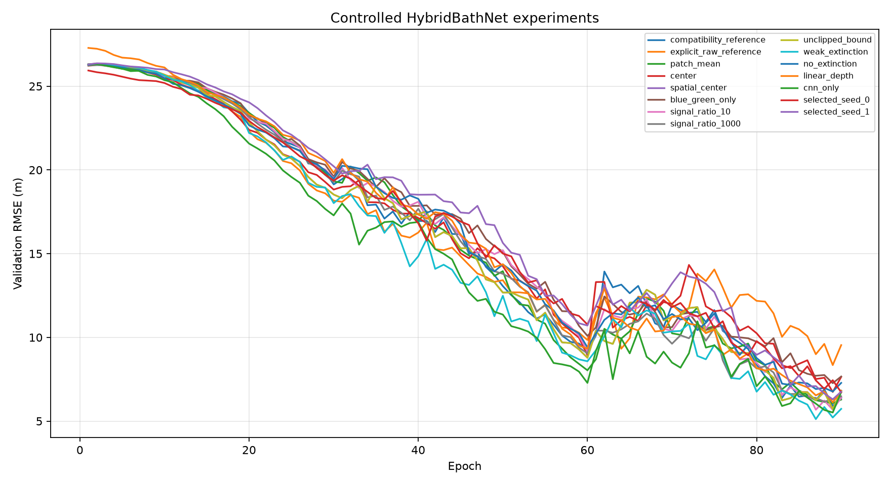

# HybridBathNet controlled study

Selected using validation only: **weak_extinction**.

| Experiment | Validation RMSE | Test RMSE | Test MAE | Test R² |
|---|---:|---:|---:|---:|
| compatibility_reference | 5.901 | 6.103 | 4.798 | 0.754 |
| explicit_raw_reference | 8.346 | 8.713 | 7.061 | 0.499 |
| patch_mean | 6.067 | 6.397 | 5.078 | 0.730 |
| center | 6.741 | 7.159 | 5.827 | 0.662 |
| spatial_center | 5.722 | 5.868 | 4.628 | 0.773 |
| blue_green_only | 7.265 | 7.648 | 5.938 | 0.614 |
| signal_ratio_10 | 5.681 | 6.154 | 4.865 | 0.750 |
| signal_ratio_1000 | 6.162 | 6.459 | 4.939 | 0.725 |
| unclipped_bound | 5.722 | 5.868 | 4.628 | 0.773 |
| weak_extinction | 5.118 | 5.335 | 4.209 | 0.812 |
| no_extinction | 6.767 | 7.200 | 5.690 | 0.658 |
| linear_depth | 6.120 | 6.267 | 4.975 | 0.741 |
| cnn_only | 5.514 | 5.930 | 4.781 | 0.768 |
| selected_seed_0 | 6.723 | 7.020 | 5.593 | 0.675 |
| selected_seed_1 | 6.303 | 6.941 | 5.670 | 0.682 |

Selected configuration over seeds 42, 0, 1: RMSE 6.432 ± 0.951 m (sample SD).

[Final configuration](weak_extinction/config.yaml) · [Checkpoint](weak_extinction/checkpoints/hybridbathnet.pt) · [All metrics](comparison.csv)

## Original comparison

The preserved historical result reports RMSE 3.5066 m, MAE 2.6732 m and R² 0.9163. Its checkpoint lacks seed/split/runtime provenance and used old six-channel features. It is not an apples-to-apples comparator. Unmodified current HEAD fails its first forward pass with a 64-versus-32-channel reconstruction-head error. The compatibility reference is therefore a repaired reference on the controlled dataset, not a reproduction of the historical score.

## Scientific interpretation and limits

The existing Kd expressions are tested heuristics; their exact blue-green coefficients and additive red term were not verified as a calibrated Sentinel-2 attenuation retrieval. Reflectance inversion was already valid for stored spectral statistics, but spectral jitter altered those inputs; the explicit-raw variants isolate physics from jitter. Signal ratios 10/100/1000 are sensitivity assumptions, not measured detection thresholds. The bound is a soft penalty, never a hard ceiling on predictions.

All variants use the same training-fitted features and 306/65/65 spatial patch split. Pixel footprints do not overlap, but adjacent patches can share coarse GEBCO reference cells. GEBCO is not independent surveyed bathymetry. Validation selection across many variants can overfit this small validation set. A new geographic site and independent optical/depth measurements are still needed.

The trainer supervises centre-pixel depths; dense reconstruction/pooling losses are not active. Uncertainty results are aleatoric Gaussian coverage; MC dropout, ensembles and conformal calibration were not evaluated. Empty/small depth bins are null with counts, not silently converted to zero.

Sources: [Wang et al. (2009)](https://agupubs.onlinelibrary.wiley.com/doi/10.1029/2009JC005286), [NASA SeaDAS KD2 example](https://appliedsciences.nasa.gov/sites/default/files/2024-02/SeaDAS_Final_1Feb.pdf).

