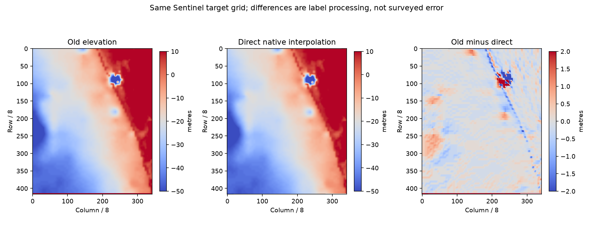

# GEBCO grid audit and matched short-training results

Completed 2026-11-05. The two 10-epoch pilots finished at approximately 15:24 IST; calibration-only reevaluation completed at 15:25. No training remains active. The existing selected expanded_smooth checkpoint is retained.

## Findings and fixes

The native NetCDF is a 72 x 61 geographic grid, with 15-arc-second cell-centre coordinates and elevations in metres (negative underwater). No gross axis flip, sign reversal or CRS mismatch was found. Source metadata includes both sea-level descriptions and an inconsistent ellipsoid standard_name, so a precise vertical-datum correction cannot be inferred from that field alone.

The old pipeline reprojected native GEBCO to a coarse UTM raster using nearest neighbour, then bilinearly interpolated that intermediate raster onto the image grid. This introduces unnecessary label distortion. The corrected preprocessing path reads the native NetCDF and performs one bilinear warp onto the requested target grid, preserving missing coverage as NaN.

| Sample locations | RMS old-minus-direct label difference | RMS direct-minus-independent interpolation |
|---|---:|---:|
| Training | 0.704 m | 0.0167 m |
| Validation | 0.238 m | 0.0036 m |
| Test | 0.218 m | 0.0041 m |

The independent check evaluates bilinear interpolation directly at geographic cell centres, separately from GDAL reprojection. It covers all held-out centres and 2,166 of 2,176 original training centres; ten training centres fall outside the native centre-coordinate interpolation hull. GDAL still provides boundary-cell coverage there. Differences are processing disagreement, **not measured seabed error**. Some local training-label differences exceed 8–12 m, although RMS across held-out centres is much smaller.

The AOI-grid constructor also used only two projected corners, missing about 118 m at the western extent and 141 m at the eastern extent. It now uses densified projected bounds and exact 10 m spacing. Sentinel and GEBCO previously shared the same destination grid: this is an AOI coverage issue, not evidence they were offset by 118 m relative to each other.

Existing rasters, feature files, historical results and checkpoints were not overwritten. The short pilot deliberately retains the old imagery grid/features to isolate the GEBCO label path. A future full rebuild must regenerate and validate its split coordinates for the corrected grid dimensions.

Native bilinear reference-support sets at sampled centres show zero shared cells between train/validation and train/test. This does not establish independence of all patch pixels or eliminate wider spatial correlation.

## Matched pilot protocol

Both arms started from the same expanded_smooth seed-42 best EMA checkpoint. Fixed imagery features, masks, normalization, seed, sample order, 10-epoch budget, lr 1e-5 cosine schedule, EMA 0.999, physics weight 0.03, depth loss and uncertainty loss. Augmentation was disabled so only centre labels needed replacement. Non-centre target values are unused by this scalar trainer and were left unchanged.

Five original training centres become non-water under the directly interpolated elevations; both arms exclude those same five, leaving 2,171 training examples. No validation or test samples were removed. These are label-validity exclusions, not exclusions based on model residuals. No test predictions were evaluated in the pilot.

Both checkpoint selection and the primary comparison use **the same corrected validation labels** at the existing 65 locations. The 10-epoch pilot is a fine-tuning diagnostic, not a from-scratch experiment on fully rebuilt features or an independent geographic benchmark.

| Model | Corrected-label validation RMSE | MAE | 68% coverage | 90% coverage |
|---|---:|---:|---:|---:|
| Starting selected checkpoint | **2.6326 m** | **2.1400 m** | 60.00% | 95.38% |
| Fine-tuned with old labels | 2.6917 m | 2.1763 m | 63.08% | 95.38% |
| Fine-tuned with direct labels | 2.6948 m | 2.1759 m | 63.08% | 95.38% |

For reference only, the same starting checkpoint has 2.5941 m validation RMSE against the old labels. Changing the reference changes the metric; that is not a model improvement.

**Neither short fine-tuning run improves on the starting checkpoint.** Their difference (~0.003 m) is not evidence of a meaningful winner. No new model is promoted. The coordinate fixes remain appropriate because they are supported by geometric/interpolation checks, not selected for a lower RMSE. This pilot does not establish that a full corrected-data training run would or would not improve.

## Joint model direction

The user explicitly clarified that physics, depth prediction and uncertainty must work **together in one model**. This remains the project design. Current training already shares the neural backbone, physics-conditioned features, depth objective, heteroscedastic uncertainty objective, and soft extinction penalty. The physics estimates currently include fixed heuristics; they are not all learned/calibrated parameters. The optical reconstruction branch runs but receives no reconstruction-loss supervision in the active scalar trainer. That is an integration gap to address in a controlled future change, not a reason to separate the components.

GEBCO/ICESat-2/survey observations are candidate **reference labels**, distinct from the three model components. Fixing or replacing the reference does not turn the model into a different non-hybrid method.

Next research priorities: finish a mask-aware physical reference test, align the active joint loss with the intended optical reconstruction/depth/uncertainty objectives, and evaluate uncertainty calibration as well as depth accuracy. Any newly activated reconstruction term needs identifiable optical parameters, consistent reflectance units, finite/masked loss handling, and ablation tests. Do not just switch on an unused config weight and assume the branch is trained.

Sentinel-only imagery can support optical reconstruction or temporal consistency pretraining; it cannot independently validate absolute depth RMSE without depth reference. A satellite-only route using Sentinel-2 plus quality-controlled ICESat-2 remains a plausible next dataset approach, contingent on actual usable AOI coverage. See [literature and research direction](../../../docs/LITERATURE_AND_RESEARCH_DIRECTION.md).

## Validation and reproducibility

All **13 tests passed**: three new grid tests (axis ordering/pixel centres, missing coverage, exact-resolution enclosing bounds) and ten existing training stability checks. Editor diagnostics and `git diff --check` passed. The NetCDF test backend emitted NumPy compatibility/deprecation warnings but completed its numerical assertions; no dependency upgrade was made during this audit.

- [Audit evidence](audit.json), [pilot protocol](pilot_protocol.json), [all pilot metrics](pilot_results.json).
- [Audit script](../../../scripts/audit_gebco_grid.py), [pilot script](../../../scripts/run_grid_pilot.py), [grid tests](../../../tests/test_gebco_grid.py).
- `python scripts/run_grid_pilot.py --evaluate-only` recomputes validation metrics from saved pilot checkpoints without training. Avoid running the training command unless explicitly intended.
- Root historical metrics and the completed 15-run/four-run studies are preserved. The existing test set remains an exploratory benchmark; do not claim a new untouched test evaluation here.
