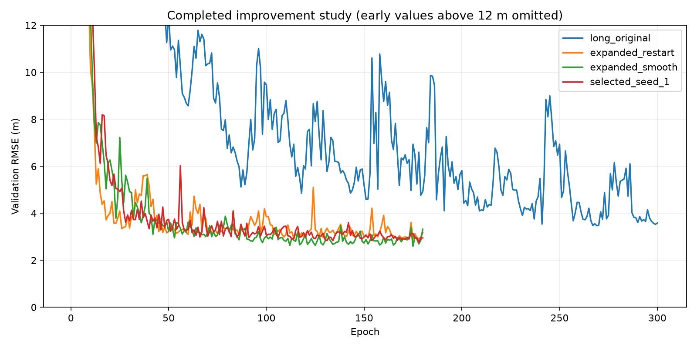

# Completed training review and next experiment decisions

Reviewed 2026-11-05. Both studies are complete. No new training was launched for this review. Evidence: [all 19 history summaries and validation diagnostics](review_evidence.json), [four-run metrics](comparison.csv), [first study metrics](../../2026-11-04/study/comparison.csv). Historical metrics are in [the preserved root results](../../../results/hybridbathnet_results.json).

## Which model should we carry forward?

**Expanded smooth, seed 42**, selected by validation RMSE before its test evaluation. Keep its [configuration](expanded_smooth/config.yaml) and [best EMA checkpoint](expanded_smooth/checkpoints/hybridbathnet.pt) as the comparator for future work. Seed 1 repeats this same configuration. Do not replace the historical model or claim superiority over it without a matched experiment.

| Run | Validation RMSE (m) | Test / historical reported RMSE (m) | Test MAE (m) | Best epoch |
|---|---:|---:|---:|---:|
| Historical six-channel model | Unknown | 3.507 | 2.673 | Unknown |
| Previous controlled weak extinction | 5.118 | 5.335 | 4.209 | 87 |
| Long original dataset | 3.474 | 4.186 | 3.401 | 269 |
| Expanded restart | 2.876 | 4.195 | 3.108 | 167 |
| **Expanded smooth** | **2.594** | **3.554** | **2.826** | **175** |
| Expanded smooth, seed 1 | 2.768 | 3.783 | 2.741 | 178 |

The 2.594 and 2.876 scores are validation results. Historical 3.507 is the reported historical test result, with incomplete split/checkpoint provenance. The new best test result is numerically slightly higher (worse) by 0.047 m. Different data preparation and evaluation splits prevent a direct ranking. The known distinction is six versus sixteen input channels; the historical network layer count was not established in this review.

Compared with the first controlled weak-extinction run, new test RMSE improves by 33.4% on unchanged held-out coordinates/labels. This supports continuing with the new configuration, but not a claim of beating the historical model or reaching 0.9 m.

## What the completed comparisons support

- **Longer training helped the original dataset:** validation 5.118 to 3.474; test 5.335 to 4.186. Most first-study best epochs were at the end of its 90-epoch budget, consistent with incomplete convergence.
- **More training patches helped validation but did not alone improve test RMSE:** expanded restart test 4.195 versus long_original 4.186. These runs also differ in total optimizer updates and train-fitted feature references, so the data-size effect is not perfectly isolated.
- **Smoother scheduling helped in the matched expanded-data seed-42 comparison:** validation 2.876 to 2.594; test 4.195 to 3.554. Both expanded runs used 180 epochs, the same dataset, batch size and EMA decay. The restart period changed from 30 to 180.
- **The repeat seed is encouraging, not proof of stability:** seed-1 test 3.783 is close to seed-42 3.554, but two runs are too few for robust variability claims. Both are better than the previous controlled study's three seeds (5.335, 7.020, 6.941 test RMSE).
- **Further epochs may help modestly:** expanded smooth's best in epochs 1–90 was 2.871; its overall best was 2.594 at epoch 175. This is a smaller gain than the first round of longer training. There is no measured training-set RMSE here, so training loss versus validation RMSE cannot establish overfitting.
- All 19 saved histories have finite loss, validation RMSE, MAE and R2. Sparse-bin nulls are intentional and are not NaN training failures.

## Remaining errors, measured on validation

Selected model's mean residual is -0.088 m; a global offset correction is unlikely to solve the remaining error. Five of 65 validation examples contribute 38.4% of total squared error. Investigate their coordinates and data quality; do not delete them for better metrics.

| Reference depth | Count | RMSE (m) | Mean prediction minus reference (m) |
|---|---:|---:|---:|
| 0–10 m | 8 | 1.552 | +0.882 |
| 10–20 m | 18 | 2.277 | +0.201 |
| 20–30 m | 21 | 2.683 | -0.324 |
| 30 m and deeper | 18 | 3.107 | -0.534 |

The shallow bin has only eight observations and is exploratory. Error increases with depth in this validation set. This does not justify changing the reported domain or discarding deep examples after seeing their errors.

The earlier optical bound mismatch remains: selected-model test mean bound is 6.234 m and 95.38% of references exceed it. The weight is weak (0.03), not a hard prediction ceiling. The exact attenuation formula is still a heuristic; reducing penalties is not a calibration of optical physics.

Equal-weight averaging of the two smooth-model validation predictions gives **2.619 m**, worse than selected seed 42's 2.594 m. Their residual correlation is **0.924**, suggesting shared errors. An ensemble is therefore not the first recommended improvement. No ensemble test score was calculated for model selection.

## Next experiments, in priority order

### 1. Test full training coverage without replacement

Verified behavior: the depth sampler forms five quantile strata containing 435, 435, 435, 435 and 436 examples. It draws 436 per stratum **with replacement**. Reproducing seed 42's first epoch yields 2,180 draws but just **1,355 unique patches**, leaving 821 training patches unseen in that epoch. These strata balance quantile groups, not equal-width shallow/deep metre ranges. The current sampler can see omitted examples in later epochs, so this is not permanent data loss.

Proposed controlled change: shuffle each stratum without replacement and interleave/shuffle all examples; handle only the tiny count difference explicitly. Preserve every training index once per epoch. Compare against expanded_smooth with identical seed, schedule, features and loss, then repeat the winner with another seed. Check coverage, determinism, resume state and distribution before launching. Better RMSE is a hypothesis, not assured.

### 2. Make the model's surface-reference percentile mask-aware

Verified code behavior: `HybridBathNetModel.forward` computes `torch.quantile(g.reshape(...), 0.95)` over all patch pixels, before applying validity to conditioning aggregation. Invalid pixels can therefore affect the surface-reference prior even when they should not contribute. The feature-builder's training-only percentile is a separate calculation and does not resolve this model-level behavior.

First write a focused test: changing only invalid-pixel reflectance must not change valid-pixel physics priors. Implement masked quantiles and an explicit policy for patches without valid water; verify finite outputs. Test this separately from the sampler change to preserve attribution. Do not silently revise attenuation coefficients.

### 3. Align and measure the accuracy objective

Verified code behavior: the configuration's `w_mse` weights a normalized **Huber** term, not MSE. The NLL uses metre residuals after the earlier correction. Reconstruction/pooled terms are not active. Different scales between objective terms are not automatically a bug, but their relative influence is unmeasured.

Before tuning, log loss-component magnitudes and relevant gradient norms. Compare one change at a time: explicit normalized MSE for RMSE alignment, or lower NLL weight while retaining uncertainty safeguards. Do not assume disabling uncertainty or increasing extinction will help. The previous no-extinction ablation was worse under the earlier 90-epoch/small-data protocol; its result is not proof that the current optimum is exactly 0.03 under every training setup.

### 4. Audit the examples and reference support

Map high validation residuals to glint/cloud masks, number of clear observations, coast proximity and native GEBCO cells. Inspect preprocessing metadata before changing reflectance conversion. The expanded training set ranges to 103.2 m, while held-out sets reach about 47.3 m; document this coverage rather than trimming training to test targets. Better optical-quality filtering or more genuinely independent shallow observations may help, but criteria must be fixed without choosing favourable held-out scores.

GEBCO bilinear resampling creates many correlated pixel targets. A 32-pixel footprint buffer is verified, but it is not proof of native-cell independence. Future evaluation should group native reference cells and larger geographic regions; changing this split makes a new benchmark and can worsen scores while giving a more honest estimate.

### 5. Controlled low-learning-rate continuation

After the above, consider a modest continuation with a low maximum learning rate, validation early stopping, and a clear update budget. The existing scheduler restarts at epoch 180; increasing `epochs` alone would not implement a smooth low-LR continuation. Resume restores the scheduler state from checkpoint, overriding some YAML intentions. Add an explicit tested continuation mode if this experiment is chosen. Do not repeatedly extend runs solely because test RMSE looks promising.

### 6. Later approaches

- A matched six-channel comparison: verify/reconstruct original source and channel mapping, train/evaluate using the same reference and held-out footprints, compare multiple seeds. Merely changing `in_channels` to 6 is insufficient because the current mask/physics channel layout is hard-coded in places.
- Per-scene Sentinel training: retain date-specific reflectance and quality information. Assign every date for one footprint to the same geographic split and buffer; never scatter repeated observations across train/validation/test. Fit scene transformations only in training regions and reserve a new geographic holdout.
- Dense or native-GEBCO-cell supervision: a separate architectural/loss experiment, not simply enabling configured weights. Existing dense loss needs numerical, units and mask-pooling review. Count native reference cells rather than treating resampled pixels as independent ground truth.

## Reproducibility and present status

Review script: [review_completed_training.py](../../../scripts/review_completed_training.py). It reads stored artifacts, reproduces sampler draws, writes evidence and plots, and never trains. It does not change model behavior or checkpoints. Current status and future-assistant instructions are maintained in [PROJECT_CONTEXT.md](../../../PROJECT_CONTEXT.md).

Do not launch the above proposals automatically. The user asked for a review and stopped further training. Preserve the selected expanded_smooth checkpoint and all historical outputs until the next experiment is explicitly requested.
