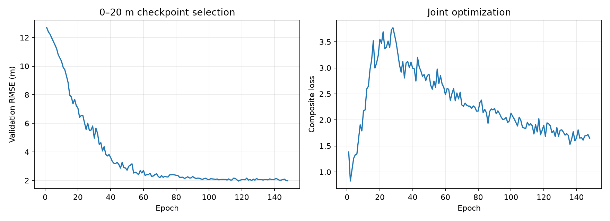
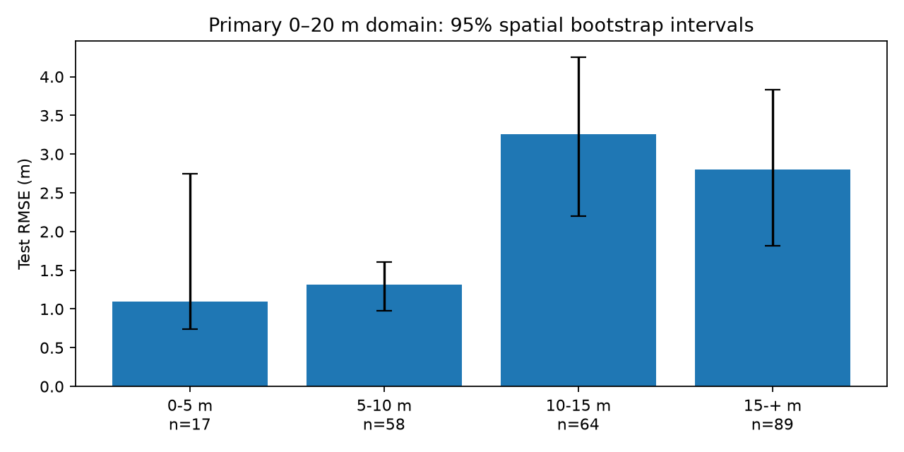

# Nearshore HybridBathNet joint-model results

Original geographic test blocks retained. Only HybridBathNet trained. Shelf eligibility <=25m applied before patch extraction; depth training/selection limited to <=20m. No sample duplication or predicted-depth clipping.

Validation RMSE (0–20m): 1.963 m.

| Test maximum reference depth | n | RMSE (m) | 95% spatial bootstrap CI | MAPE (%) | Delta <1.25 (%) |
|---|---:|---:|---|---:|---:|
| 15 | 143 | 2.386 | 1.633–3.127 | 18.0 | 67.1 |
| 20 | 228 | 2.561 | 1.840–3.261 | 15.9 | 72.8 |
| 25 | 343 | 3.434 | 2.690–4.062 | 17.1 | 65.3 |

| Primary 0–20m depth bin | n | RMSE (m) | 95% spatial bootstrap CI |
|---|---:|---:|---|
| 0-5 | 17 | 1.094 | 0.739–2.746 |
| 5-10 | 58 | 1.310 | 0.978–1.608 |
| 10-15 | 64 | 3.255 | 2.203–4.248 |
| 15-+ | 89 | 2.800 | 1.812–3.832 |

Heuristic optical-support flags cover 92.4% of test predictions. These are diagnostic flags, not a calibrated mask; all eligible samples remain scored.

The 20–25m test subset is outside the supervised training-depth range. Bootstrap intervals are conditional on the model and GEBCO, and do not include reference error. Source-cell support is disjoint across splits; within-split patches overlap. Prior 3.554m full-depth test RMSE is not a matched comparator for the new shallow samples and scope. No sub-metre real-seabed accuracy is established.

[Protocol](protocol.json) | [All results](results.json) | [Dataset audit](features/metadata.json)

## Joint-model training and uncertainty, primary 0–20 m domain

Completed 148 epochs; selected EMA epoch 118 (validation RMSE 1.963 m).

| Split | n | Mean sigma (m) | Gaussian NLL | 68% coverage | 90% coverage |
|---|---:|---:|---:|---:|---:|
| validation | 208 | 1.460 | 2.058 | 63.0% | 83.7% |
| test | 228 | 1.606 | 2.596 | 52.2% | 71.1% |

Test sigma-depth Spearman: -0.472; sigma-absolute-error Spearman: 0.232.

| Lowest-uncertainty test fraction retained | n | RMSE (m) |
|---:|---:|---:|
| 25% | 57 | 1.586 |
| 50% | 114 | 2.052 |
| 75% | 171 | 2.312 |
| 100% | 228 | 2.561 |

No post-hoc sigma calibration or test-dependent clipping was applied. These diagnostics concern errors against GEBCO, not independent bottom-detectability truth. No matched model ablation was trained under the HybridBathNet-only instruction, so component-wise accuracy gains are not established.

[Primary uncertainty metrics](uncertainty_primary_0_20.json). Optical-water audit found positive centre NDWI for all 208 validation and 343 test locations; six training centres were nonpositive. NDWI alone is not a definitive bottom/land truth, and no post-hoc data filtering was performed.

## Identical-coordinate comparison with the previous selected model

At 26 common test locations with the same corrected reference depths <=20m, the previous expanded_smooth model has RMSE 2.898 m and this nearshore model 2.552 m. The 95% paired spatial-bootstrap interval for new-minus-old RMSE is -1.350 to 0.466 m. This is a small exploratory subset with differing training pipelines/domains, not proof of architecture superiority.
