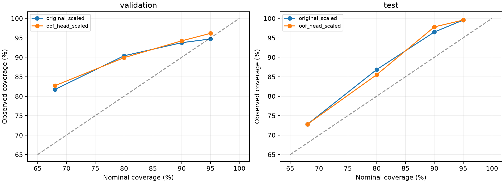
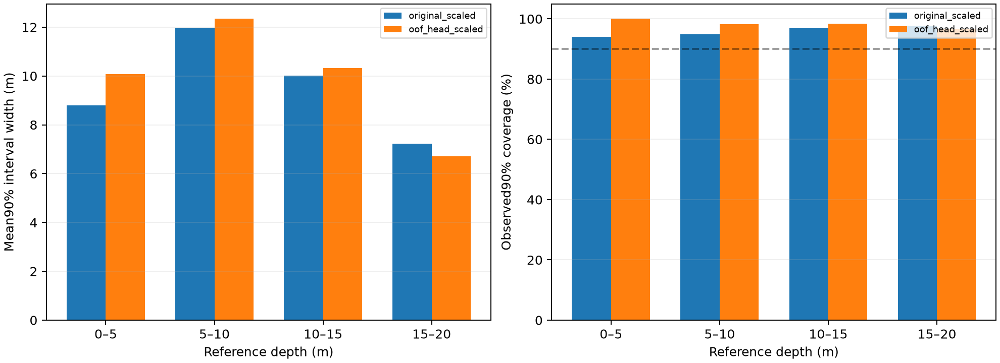
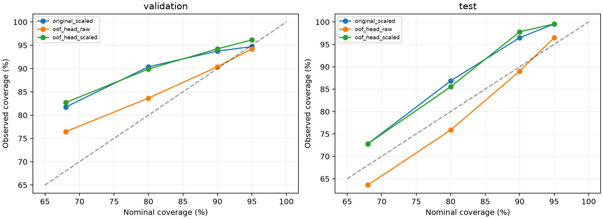
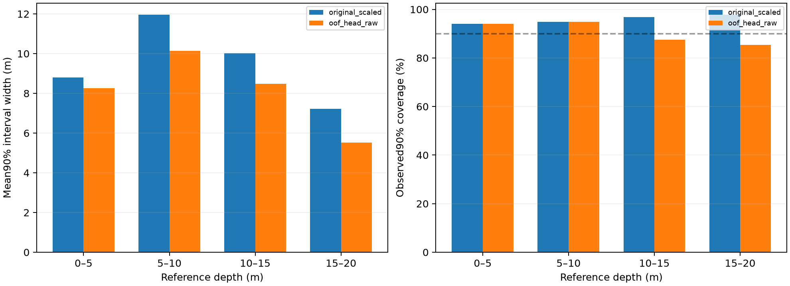

# GEBCO spatially held-out residual uncertainty study

Three fresh full HybridBathNet fold models generate447 OOF error examples. Training/source-cell buffers and feature refitting exclude every point from its own fold fit. A small spatial correction head learns total-risk multipliers from these errors; its checkpoint is selected by external-validation NLL, including the identity epoch0 control.
The final depth means and raw aleatoric/epistemic components come from the original frozen three-member GEBCO ensemble. A separate123-point calibration set fits one sigma multiplier after head selection. No test fitting, depth correction, mask or held-out removal occurs.

Selected risk-head epoch:4. Original/new residual sigma calibration multipliers:1.758801/1.217809.

| Variant | Val90% coverage | Val width(m) | Val CRPS | Test90% coverage | Test width(m) | Test CRPS |
|---|---:|---:|---:|---:|---:|---:|
| original_raw | 80.3% | 4.95 | 1.197 | 70.6% | 5.30 | 1.345 |
| original_scaled | 93.8% | 8.71 | 1.219 | 96.5% | 9.33 | 1.321 |
| oof_head_raw | 90.4% | 7.14 | 1.188 | 89.0% | 7.73 | 1.306 |
| oof_head_scaled | 94.2% | 8.69 | 1.215 | 97.8% | 9.41 | 1.320 |

| Test bin | n | Previous/new90% coverage | Previous/new width(m) | Previous/new interval score90 |
|---|---:|---:|---:|---:|
| 0-5 | 17 | 94.1/100.0% | 8.80/10.07 | 9.347/10.066 |
| 5-10 | 58 | 94.8/98.3% | 11.95/12.34 | 12.380/12.434 |
| 10-15 | 64 | 96.9/98.4% | 10.02/10.33 | 10.196/10.417 |
| 15-20.0001 | 89 | 97.8/96.6% | 7.23/6.71 | 7.965/7.489 |

Predefined validation narrowing gate passed:True. It requires narrower90% intervals, at least90% validation coverage, and non-worse validation interval score/CRPS. This is an exploratory assessment, not a coverage guarantee or automatic model promotion.

Validation/test depth RMSE stays2.219/2.372m. Primary test has228 fixed centres. Source v1 remains the validation-selected depth reference; this experiment does not promote the research ensemble.
Test sigma/error Spearman previous/new:0.162/0.187. Paired spatial95% intervals for new-minus-previous scores/width and new coverage are in[results.json](results.json).

Limitations: fold models train on188/236/262 points, less than the final447-point source ensemble; their single-model error distribution differs from the final ensemble. Shared outer validation selects both depth-fold and correction-head checkpoints. Calibration and test remain separate, but the historical test was already inspected, so comparisons are exploratory. GEBCO is a coarse reference, not independent seabed survey truth. Narrowing alone is not improvement if coverage or proper scores degrade. Learned total-risk correction does not identify new pure aleatoric/epistemic components.

[Protocol](PROTOCOL.md) | [Source fold split/feature audits](folds.json) | [Head protocol](risk_head/protocol.json) | [Frozen calibration](calibration_frozen.json) | [Per-location test values](test_predictions.csv)

Strict head reload, original ensemble checkpoint hashes, fold dataset hashes and exactly-once OOF coverage verified. [Verification](verification.json).

## Raw versus additionally scaled correction head

Both variants were predefined. The extra calibration multiplier does not achieve the desired test narrowing:9.41m width versus9.33m previously, at97.8% coverage. Do not describe this scaled result as a width improvement.

The raw learned correction head is the promising alternative: validation width7.14m at90.4% coverage, test width7.73m at89.0% coverage (203/228). Compared with previous globally calibrated uncertainty, widths decrease18.1% on validation and17.2% on test. Validation CRPS1.219→1.188m and test1.321→1.306m improve slightly; test90% interval score9.817→9.050m. It passes the same descriptive validation narrowing criteria without needing the extra multiplier. This is not a claim that it was selected before seeing historical tests, nor a coverage guarantee.

Raw learned-head test coverage by bin0–5/5–10/10–15/15–20m is94.1/94.8/87.5/85.4%, with widths8.27/10.13/8.48/5.51m. The deep bins still under-cover; do not present the aggregate89% as uniform90% reliability. Physics/depth means and original aleatoric/epistemic components remain unchanged. No optical mask is enabled.

[Paired spatial intervals and variant review](variant_review.json). Keep the learned raw head as an explicit research candidate, preserve the prior calibration option and all checkpoints, and examine independent geographic validation before default deployment. Future conditional calibration should be learned without tuning to these test bins. All39 project tests and the strict source/head verification checks passed; no training remains active.

