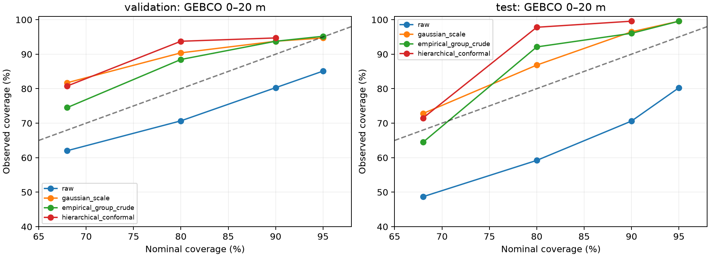

# GEBCO uncertainty calibration: completed comparison

The full physics/depth/uncertainty networks and three independently trained ensemble members remain frozen. Fits use only123 separate calibration points in15 geographic groups. No training data, test locations, optical masks or depth predictions changed.

Primary candidate: group-balanced Gaussian variance scaling. Other methods and comparison levels were predefined; no test score selects a method.

| Method | Validation90% coverage | Validation width (m) | Test90% coverage | Test width (m) | Test interval score90 (m, lower better) |
|---|---:|---:|---:|---:|---:|
| raw | 80.3% | 4.95 | 70.6% | 5.30 | 11.037 |
| gaussian_scale | 93.8% | 8.71 | 96.5% | 9.33 | 9.817 |
| empirical_group_crude | 93.8% | 9.20 | 96.1% | 9.85 | 10.388 |
| hierarchical_conformal | 94.7% | 10.22 | 99.6% | 10.94 | 11.124 |
| group_max_conformal | 98.6% | 15.99 | 100.0% | 17.12 | 17.119 |

Mean per-point coverage is shown above; equal-group metrics,68/80/95% sensitivity, Gaussian/empirical CRPS and spatial paired intervals are in[results.json](results.json). HCP95% intervals are unbounded with15 calibration groups, correctly retained rather than silently capped.

| Primary scaling: test depth bin | n | Raw90% coverage | Scaled90% coverage | Raw/scaled width (m) |
|---|---:|---:|---:|---:|
| 0-5 | 17 | 88.2% | 94.1% | 5.00/8.80 |
| 5-10 | 58 | 89.7% | 94.8% | 6.80/11.95 |
| 10-15 | 64 | 59.4% | 96.9% | 5.70/10.02 |
| 15-20.0001 | 89 | 62.9% | 97.8% | 4.11/7.23 |

Fitted total-sigma multiplier: 1.758801. It does not separately identify corrections to aleatoric and epistemic uncertainty. Original raw components are preserved.
Validation/test RMSE stays 2.219/2.372m. Correcting prediction intervals cannot improve point-depth RMSE or the scalar uncertainty ranking.

The prior group-max interval targets simultaneous coverage of a whole group; the new methods target pointwise uncertainty. Narrower intervals alone therefore do not establish a stronger statistical guarantee. HCP uses the published infinity-atom correction; its hierarchical exchangeability assumptions are not verified for this AOI. Scaling and empirical calibration have no distribution-free guarantee here. Previously inspected test results are exploratory.
The CRUDE adaptation uses residual=(observed−predicted)/sigma, so positive errors shift upper quantiles upward. Depth means stay unchanged even if the calibrated uncertainty distribution is asymmetric. CRPS compares raw/scaled Gaussian moment distributions and the empirical calibrated distribution; conformal sets have no assigned CRPS or Gaussian likelihood.

The existing model ranking remains unchanged: the ensemble is a research candidate and preserved v1 remains the validation-selected GEBCO reference. This report improves/assesses interval estimation only.

[Predefined protocol and literature](PROTOCOL.md) | [Calibration-only fits and leave-group-out diagnostics](calibration_frozen.json) | [Per-location test intervals](test_intervals.csv)
Checks: numerical tests for analytic scaling, equal-group weights, empirical sign/CRPS, interval score, HCP infinity atom and rank; identical member target order; unchanged RMSE; all fits frozen before new held-out evaluation.

## Follow-up diagnostics and deployment limits

Scaling raises mean total test sigma from1.612m to2.836m. Head and ensemble component values remain raw and separately preserved. Inference-only state reload reproduces saved intervals to1e-12 without labels. [Per-location calibrated sigma/intervals](test_calibrated_uncertainty.csv) | [Source manifest](source_manifest.json).

Across the predefined68/80/90/95% levels, mean absolute test coverage discrepancy falls from18.56 to5.68 percentage points. This descriptive calibration metric is not a proper score or a guarantee. Test Gaussian CRPS changes from1.345 to1.321m, while validation CRPS worsens from1.197 to1.219m.

The primary90% test interval-score change is-1.220m, paired spatial95% interval[-3.614,0.866]m, which includes zero. Leave-one-calibration-group-out coverage was only80.7% for scaling, showing substantial calibration-group instability. The final full-calibration test coverage96.5% overshoots90%; improved undercoverage is not perfect calibration or proven uniform improvement.

Recommendation: preserve this as an explicit calibrated-interval research option, with raw components alongside it. Do not silently replace model checkpoints or enable optical/error masking. Further work should retain shallow training support and expand independent spatial calibration coverage; improving ranking needs better variance features/held-group residual learning, not another global multiplier. No depth RMSE gain is claimed.

All37 project tests passed, including6 focused calibration tests. Compilation and diff checks passed; no new training job is active.

