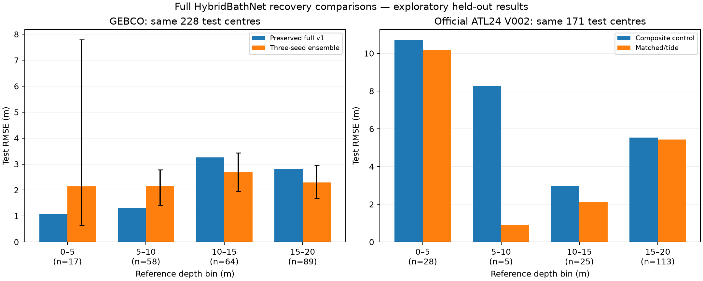
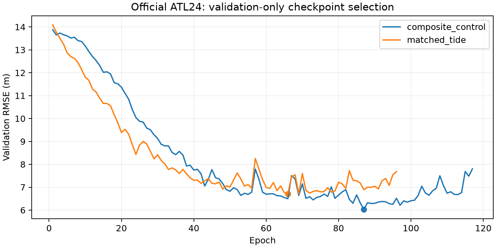

# HybridBathNet recovery results — 6 November 2026

The encoder, depth, physics conditioning/reconstruction and uncertainty modules remained active. Training used the composite depth Huber + Gaussian NLL + extinction + optical reconstruction objective. RMSE is calculated separately against reference depths in metres, not from the composite loss.

## GEBCO uncertainty/ensemble experiment

| Model | Validation RMSE0–20m | Test RMSE0–20m | Test raw90% coverage |
|---|---:|---:|---:|
| Preserved full v1 | 1.963m | 2.561m | 71.1% |
| New single seed42 | 2.254m | 2.501m | 68.0% |
| New three-seed ensemble | 2.219m | 2.372m | 70.6% |

Same test points/targets,228 centres. New447 train/123 calibration/208 validation/343 total test; v1 had637 train and no independent calibration subset. This changes data allocation/feature fitting and averaging as well as the variance head. V1 remains selected: the ensemble has worse validation and shallow-bin errors. Test results are exploratory because this holdout has already been inspected.

| Test bin | n | Preserved v1 RMSE | Ensemble RMSE | Ensemble95% spatial CI |
|---|---:|---:|---:|---|
| 0-5m | 17 | 1.094m | 2.136m | 0.639–7.794m |
| 5-10m | 58 | 1.310m | 2.173m | 1.421–2.779m |
| 10-15m | 64 | 3.255m | 2.687m | 1.956–3.431m |
| 15-20.0001m | 89 | 2.800m | 2.295m | 1.682–2.953m |

Ensemble minus v1 paired spatial-bootstrap95% RMSE difference: [-0.562, 0.278]m. Intervals are conditional on these fitted models/coarse reference, not survey accuracy or seed variability.
The dedicated15-group conformal calibration gave 100.0% test coverage but widened mean90% intervals from 5.31m to 17.12m. Broad coverage is not precise uncertainty. Raw sigma/error rank correlation is 0.162. Geographic exchangeability is not guaranteed; calibration changes interval widths, never RMSE.

[Full uncertainty results and15/20/25m sensitivity](gebco_uq/uncertainty_comparison.json) | [Reference comparison and bin intervals](gebco_uq/historical_reference_comparison.json)

## Optical visibility and physics

Applied Richardson et al.2024 published TOA visibility weights on the native10m January13 image, with11 bands and20 documented neighborhood/geographic features. The inspected-source feature check matches exactly; independent NumPy/PyTorch dense inference differs by5.5e-7. The original TensorFlow end-to-end runtime was not executed. All208 validation and343 test locations were classified p(shallow)<=.4; no held-out point meets the recommended>=.6 optical-support threshold. This is a failed usable-coverage gate, not proof that all bottoms are physically invisible. Domain/date/atmospheric/bottom conditions remain possible explanations, and local visibility labels are missing.
No operational optical mask was enabled, and the trained heuristic z_ext was not relabeled a validated Sentinel depth limit. A visibility probability is not itself an attenuation coefficient or depth in metres. Estimating a reliable metre-valued limit still needs locally validated water/background/contrast/noise observations and independent visibility/depth calibration.
[Numerical/source check](visibility/feature_reference_check.json) | [Point assessment](visibility/visibility_assessment.json) | [Author model/source](https://github.com/yulunwu8/Optically-Shallow-Deep)

## Official ATL24 recovery and water-level correction

The protected token worked after refresh. All74 official ATL24 V002 granules were downloaded and HDF5-verified. They contain8,615,803 AOI photons and4,444 class40 bottom photons. Product-quality screening and median aggregation precede the0–20m domain screen. Original test geography is preserved. The official source yields700 training-region,143 validation-region and171 test-region pixel/pass labels before optical eligibility/buffers.
Nearest<=2m same-date/pass/beam crossmatch with the older public subset gives215 finite depth pairs: median absolute difference0.105m, p90.480m. This approximate matching does not establish identical photon identity or exact public version. No universal height-sign error was found. Confidence is not depth sigma; invalid_kd marks missing VIIRS auxiliary data, and the ATLAS sensor-depth flag does not certify Sentinel visibility.
Median horizontal sigma is about7.1m; many pixel labels still contain one bottom photon. V002 documented quality limitations remain. Product-reference and positional uncertainties are audited but not yet fully propagated into the likelihood.
Downloaded public EOT20 and used pyTMD2.2.8. Against held-date ATL24 sea-surface estimates, strict tide interpolation RMSE0.173m vs constant0.301m; coastal<=10km extrapolation0.269m vs0.333m. A constant offset was fitted on earlier dates only. This validates some relative water-level variation, not a tide-gauge-grade datum or surge correction. For matched images: z_scene=z_ATL+tide(scene)−tide(ATL); the constant datum offset cancels.
[Official audit](official_quality_audit.json) | [Tide validation](tides/validation.json) | [EOT20 source](https://doi.org/10.17882/79489) | [NSIDC V002 guide](https://nsidc.org/sites/default/files/documents/user-guide/atl24-v002-userguide.pdf) | [V002 known issues](https://nsidc.org/sites/default/files/documents/technical-reference/icesat2_atl24_known_issues_v002.pdf)

## Paired ATL24 training

Both full-model arms completed; same official labels/locations/settings. Predictions are transformed back to identical ATL24 acquisition-relative targets before these scores.

| Arm | Validation RMSE | Test RMSE | Raw90% coverage |
|---|---:|---:|---:|
| composite_control | 6.027m | 6.512m | 88.3% |
| matched_tide | 6.713m | 6.093m | 90.1% |

Paired95% spatial interval for matched minus control test RMSE: [-1.363, 0.501]m.
On the29 historical-clear test locations, control RMSE5.207m versus matched5.869m. The lower overall matched RMSE arises in the142 fallback locations (6.747 to6.137m); this does not establish that contemporaneous inputs improved their own paired locations. All input/fit/model changes can affect all predictions. Neither the validation score nor the paired overall interval supports promotion.
[Paired report with bins, cutoffs and fallback strata](atl24_paired/REPORT.md). This is a different reference set from GEBCO and old public ATL24. Do not compare absolute RMSE across them as a model gain. ATL24 labels were restricted to0–20m, so its25m sensitivity has no additional samples.

## Interpretation and next work

Training-bin counts0–5/5–10/10–15/15–20m changed from[56, 131, 191, 259] to[28, 52, 156, 211] when independent calibration geography and buffers were reserved. Lost shallow supervision is a plausible contributor to the shallow regression, not a proven isolated cause. Group-max conformal targets simultaneous coverage of an entire sampled group; its broad intervals should not be presented as an efficient pointwise calibration method. Raw ensemble intervals use a Gaussian moment approximation; the reported likelihood is the actual Gaussian mixture.
Reference-only leave-one-photon-out25m profile diagnostics find insufficient neighbors for56–70% of shallow photons. Larger local residuals can indicate roughness/slope or classification errors; flags were never used to remove held examples. Nearest acquisition-time crossmatching is also ambiguous: the median match has four candidate returns and2795 of3158 have multiple candidates. Nearest-time class counts cannot establish actual per-photon version disagreement; immutable public photon indices are absent. [Profile evidence](profile_diagnostics.json) | [Photon matching ambiguity](photon_time_crossmatch.json).
GEBCO being easier to predict does not establish better seabed truth. It is a smooth coarse grid interpolated to10m, while ATL24 has sparse, correlated tracks, different locations/depth distribution, class errors and positional/water-level uncertainties. The old experiment additionally paired2018–2024 depths with2024 imagery. The original HybridBathNet paper uses dense NOAA lidar rather than our sparse public ATL24 setup. Tide differences at the measured scale cannot alone explain the old10m deep-bin bias.
Retain v1 as the validation-selected GEBCO comparator. Keep the ensemble as an exploratory deeper-bin candidate. Further uncertainty work should address shifted calibration geography, reference noise and independent spatial coverage rather than reporting wide intervals as solved calibration. Further optical work needs aquatic correction and local bottom-visibility evidence; do not force a mask with zero support. Future ATL24 work should use track/profile continuity, realistic footprint uncertainty and additional independent shallow coverage within the same AOI, with fixed held-out geography.
[Project handoff](../../../PROJECT_CONTEXT.md) | [Primary-source research and distinctions](../../../docs/HEADS_OPTICAL_LIMIT_RESEARCH_2026-11-06.md)
Checks:31 unit tests pass. All five new checkpoints strictly reload; first8 validation depth predictions match saved CUDA evaluation exactly, sigma differences<=4.8e-7m, and dataset hashes match. The initial CPU comparison differed by about1.5mm; same-device checks avoid conflating backend arithmetic with reload correctness. [Reload/environment record](verification.json). Historical checkpoints, datasets and root results were preserved during this recovery. No Stumpf, Random Forest or CNN baseline was trained. All five training jobs are completed; none remains active. [Manual continuation/report commands](../../../RUN_TRAINING_MANUALLY.md).
